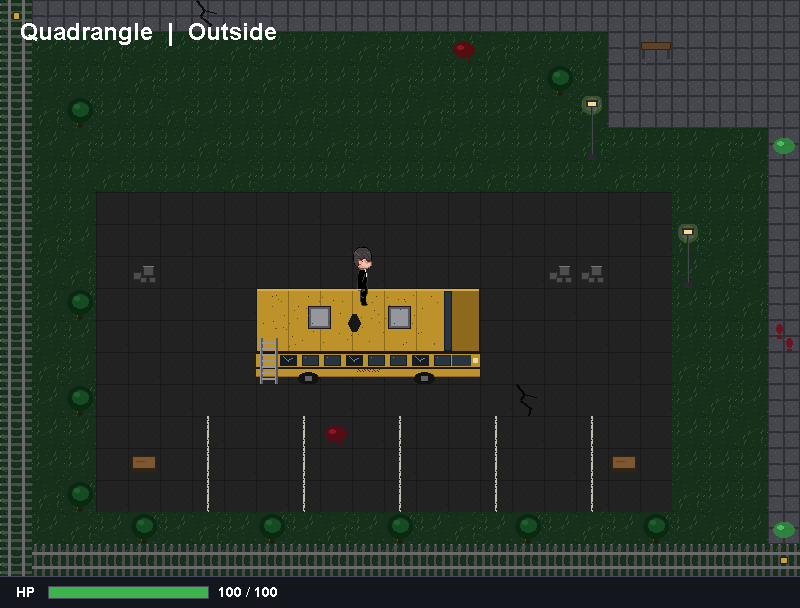

# Nightmare in Room 404

A top-down 2D horror game made with Java Swing. You start in Room 404, on the top floor of a school that's gone very wrong. From there you work your way down through the library and the labs, past the ground floor's offices, and out to the quadrangle, where the last stand will happen.



**Controls:** `W` `A` `S` `D` to walk. Walk into a door or onto the stairs to use them.

## Running the game

You need **Java 21 or newer**.

- **In Eclipse:** open `src/main/java/nightmare404/main/Main.java`, then right-click → *Run As → Java Application*.
- **As a standalone file:** double-click `build-jar.bat`. It builds `dist/NightmareInRoom404.jar`, which you can double-click, or run with:
  ```
  java -jar dist/NightmareInRoom404.jar
  ```

## Sharing the game

Double-click `build-exe.bat`. After a minute it makes **`dist/NightmareInRoom404-windows.zip`** (about 25 MB). The zip contains the game and a small copy of Java, so **the people you send it to don't need to install anything**.

Upload the zip to Google Drive (share it as *Anyone with the link*) or attach it to a GitHub Release, then send the link. To play:

1. Download the zip, right-click it → **Extract All**. Running the game from inside the zip won't work.
2. Open the `NightmareInRoom404` folder and double-click **`NightmareInRoom404.exe`**.
3. If Windows says *"Windows protected your PC"*, click **More info → Run anyway**. Windows shows this for any program that isn't digitally signed.

Keep the `.exe` inside its folder: it needs the `app` and `runtime` folders next to it. The zip only works on Windows. Anyone on a Mac needs the JAR and Java 21 instead.

## Checking nothing broke

Double-click `run-checks.bat`. It plays through every floor without opening a window and prints `ok` or `FAIL` for each test, 198 in all. Run it after changing the code or a map.

## What's where

```
src/main/java/nightmare404/   the game's code
    main/     Main, GamePanel: the window, the game loop, the camera, the keys
    entity/   Player
    ui/       BottomUI
    tile/     the tile engine: TileSet, TileMap, MapBuilder, Staircase
    map/      the map designs: Classroom, Hallway, Stairs, Library, Lab, Office, Ground, Quadrangle
    world/    World, Floor, Room: how the places link together
src/main/resources/           the sprites and tiles
src/test/java/nightmare404/   checks/ (run by run-checks.bat) and debug/ (tools that save pictures)
docs/                         the devlog and the step-by-step guides
tools/art/                    the Python scripts that made the tiles
```

The [project structure guide](docs/project-structure-guide.md) explains each part.

## The guides

Written step by step, for a beginner, in the order the game was built:

1. [Floor 4 and the hallway](docs/hallway-guide.md): the classrooms, the hallway, and the world as a linked list
2. [Floor 3 and the library](docs/floor3-library-guide.md): working stairs, and a three-screen room behind a big double door
3. [Floor 2 and the labs](docs/floor2-lab-guide.md)
4. [Floor 1, the ground floor](docs/floor1-ground-guide.md): the offices, the grass and the exits
5. [The view over the railing](docs/railing-view-guide.md): showing the real floor below
6. [The quadrangle](docs/quadrangle-guide.md): one big map, a 2D camera, and three strongholds for the last stand
7. [The project structure](docs/project-structure-guide.md): how the project is organised, and why

The [devlog](docs/devlog.md) records every session: what was built, what went wrong and why each decision was made.
