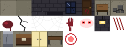
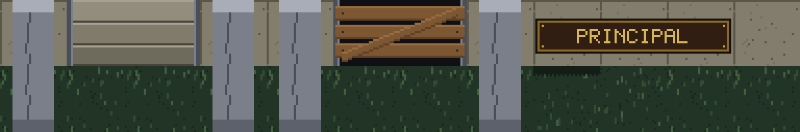
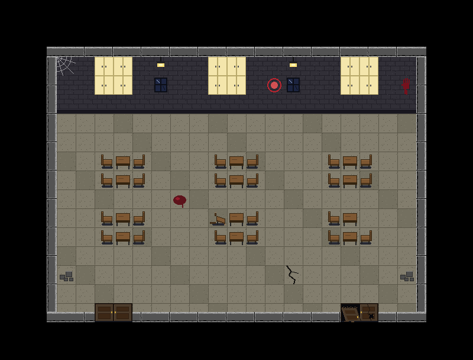
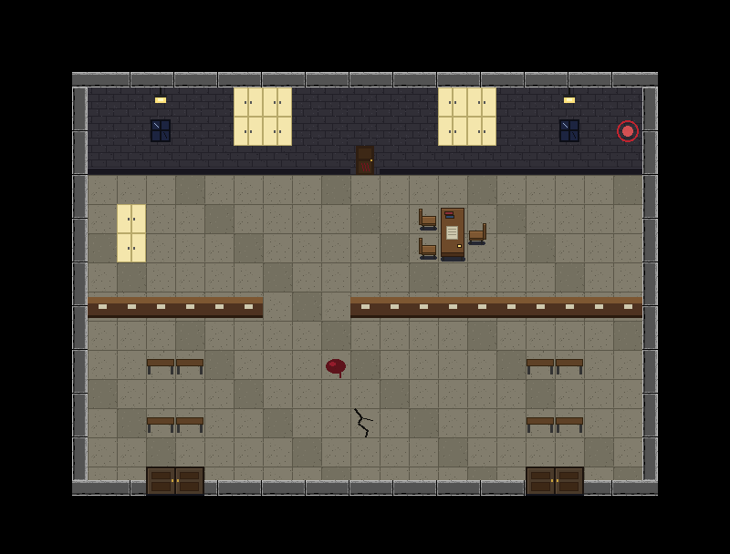
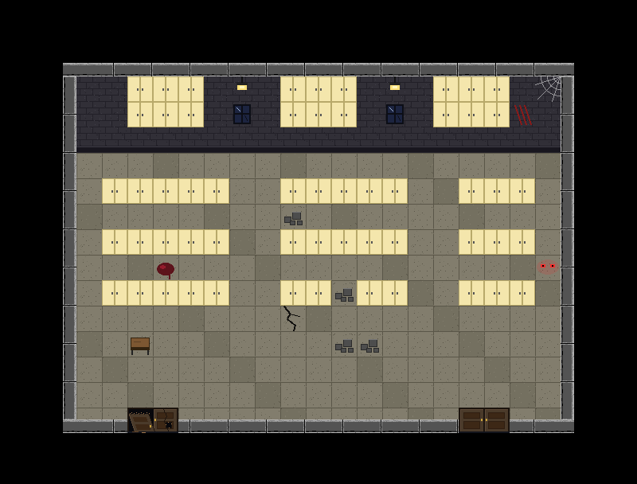
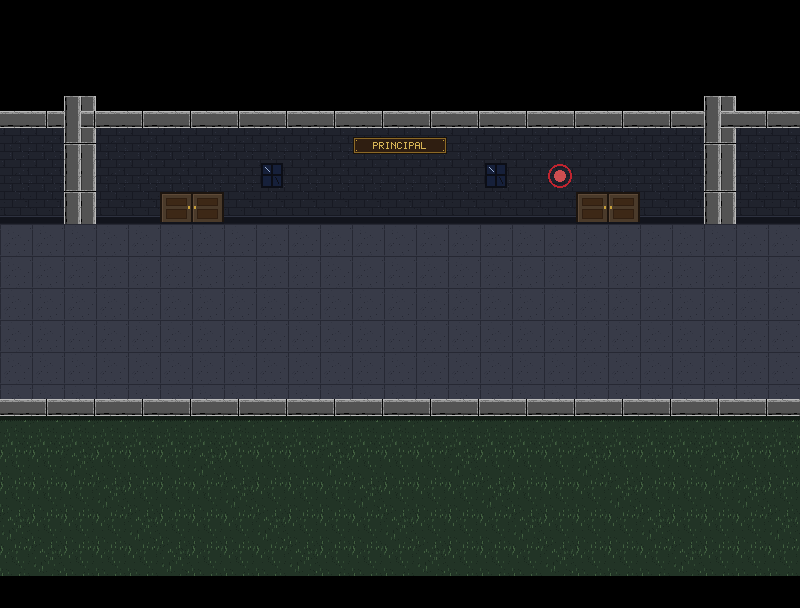
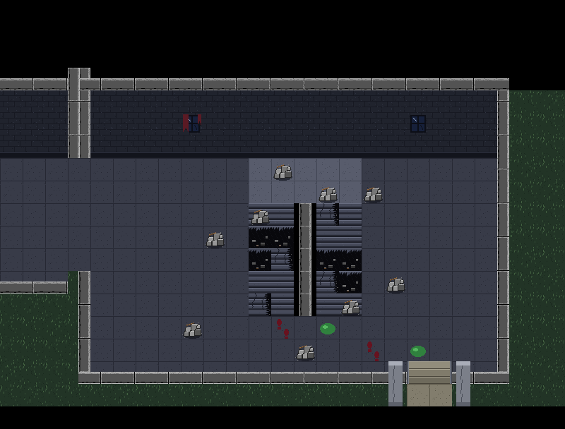
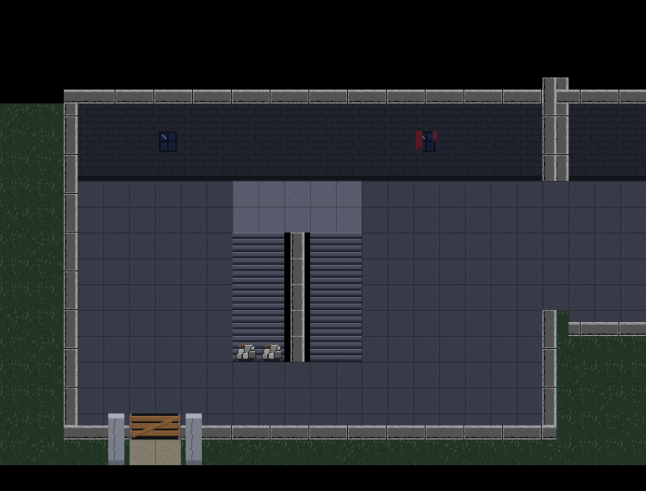

# Floor 1: The Ground Floor — a step-by-step guide

This guide follows on from [`floor2-lab-guide.md`](floor2-lab-guide.md). Here's what was added:

> **Update (2026-11-12):** the way out has moved. Both side exits are now **boarded up**, and the school's **main entrance** is in the middle of the ground floor: a doorway 4 tiles wide in the corridor's low front wall, in front of the Principal's Office (`Hallway.mainEntrance`), linked to the quadrangle with `Floor.addOutside`. Floor 1 is also reached by the west stairs from Floor 2, but the way down alternates ends on every floor. See the 2026-11-12 entries in [`devlog.md`](devlog.md). The rest of this guide describes the first version.

- **Floor 1**, the ground floor, reached by going down the west stairs from Floor 2.
- **Three offices**: the Faculty Room, the Principal's Office and the Records Room.
- **The outdoors**: the corridor looks out on **grass** instead of the floor below.
- **Two exits**, one at each end of the building, each between **two support pillars**. The west exit is **boarded up**; the east exit is **the way out**.
- **The exit is ready for the quadrangle**: it's a door like any other, so the next level attaches with one line.
- **31 new tiles** from your ground sheet: cut out, plus a 2-tile pillar, grass, the two exits and three brass plaques.

---

## The big picture

```
Floor 4   [West Stairs]<->[ ... classrooms ... ]<->[East Stairs]
Floor 3   [West Stairs]<->[ ... library ... ]<->[East Stairs]
Floor 2   [West Stairs]<->[ ... labs ... ]<->[East Stairs]
Floor 1   [West Stairs]<->[Hallway Faculty]<->[Hallway Principal]<->[Hallway Records]<->[East Stairs]
           exit: boarded up      |                  |                   |            exit: open
                          [Faculty Room]  [Principal's Office]  [Records Room]           |
                                                                               (the quadrangle, next)
```

The floor list is now four long: `floor4 -> floor3 -> floor2 -> floor1`.

### How the request was read

| You asked for | What was built |
|---|---|
| "it's on the ground so there's now grass" | Beyond the corridor's low wall there's grass, where the upper floors show the floor below |
| "there's still walls on the bottom" | The low wall along the corridor stays (you can't walk onto the grass), and the stairwells keep their walls |
| "two pillars on both ends that support the building, accompanying two exit places" | Each stairwell has an exit in its bottom wall, with a 2-tile-tall stone pillar on each side |
| "the left one is blocked and the usable one is on the left" | These two halves contradict each other. **The west (left) exit is boarded up and the east (right) one is open**, reversing the upper floors (where the west stairs work and the east ones are wrecked). The player also has to cross the whole ground floor to get out. |

**To swap the exits**, change these two words in `World.java`:

```java
Stairs.westGround(tiles, ts, Ground.Exit.BLOCKED)   // -> OPEN
Stairs.eastGround(tiles, ts, Ground.Exit.OPEN)      // -> BLOCKED
```

and set `groundExit` to `westStairs1` instead of `eastExit`.

---

## Step 1 — Reading the ground sheet



It's 8 × 3 tiles: the same template as the other two sheets, in a **neutral stone-grey** palette (floor `(130, 125, 109)`, brick `(49, 47, 55)`). It's lighter than the labs and cooler than the library, which suits a lobby and office floor. The new pieces in the bottom row:

| Piece | Used as |
|---|---|
| Cracked stone pillar | the support pillars beside the exits |
| Reception counter | the counter across the Principal's Office (it repeats sideways into one long counter) |
| Cream double cabinet | cupboards and rows of filing cabinets |
| Long bench | the waiting area |
| Red ring | a fire-alarm bell on the walls |

### Checking the checker

While comparing this sheet with the others, the check said the floor tile was "identical" to the library's, even though the colours are obviously different. That exposed a bug in the comparison code: on images with transparency, Pillow's `getbbox()` only looks at the transparency, not the colour. Comparing every byte instead showed:

- the six see-through decals (blood, crack, two cobwebs, handprint, glowing eyes, scratches) **really are identical** in all three sheets, so they're reused;
- the lamp, table, boxes and bloody door are **different** in each sheet, because each has its own background.

The same bug had produced a wrong explanation in the Floor 2 guide, which has been corrected. The game itself was never affected.

---

## Step 2 — Making the tiles

**Folder:** `src/main/resources/tiles/ground/` (31 files)



### Cut from the sheet (13)

Floor ×2, wall, wall base, window, bloody door, table, boxes, lamp, counter, cabinet, bench, fire alarm.

### A 2-tile pillar (2)

The sheet's pillar is one tile tall: a **cap** (rows 0–5), a **cracked shaft** (rows 6–25) and a **base** (rows 26–31). To make it 2 tiles tall, the cap and base are kept and the shaft is **repeated** to fill the middle:

```
row y of the tall pillar  ->  row of the original
y < 6                     ->  y            (cap)
y >= 58                   ->  y - 32       (base)
otherwise                 ->  6 + (y - 6) % 20   (shaft, repeated)
```

`%` (remainder) makes the shaft rows go 6, 7 … 25, 6, 7 … again. The pillar's floor-coloured background was made transparent, so it can stand on grass. It's then cut into `pillar_top` and `pillar_bottom`.

### Grass (3)

Drawn for **night-time**: dark, muted greens, with random short strokes for blades of grass. A fixed random seed means the same tile comes out every time. `grass_edge` has a dark band across its top, the shadow of the ledge above it. Two plain variants are mixed in a scattered pattern so the grass doesn't look like a grid. If your quadrangle sheet has its own grass, it can replace these files.

### The exits (4)

| Tile | Look | Walkable? |
|---|---|---|
| `exit_l` + `exit_r` | three stone steps between stone door jambs | yes: it's a door |
| `exit_blocked_l` + `_r` | the same doorway, dark behind, with planks nailed across and one diagonally | no |

### Plaques (9)

FACULTY, PRINCIPAL and RECORDS, 3 tiles each, in wood and brass like the library's plaque. That suits the formal office floor. The pixel font gained D, F, P and U.

---

## Step 3 — One "single-screen room" builder for labs and offices

**Files:** [`SingleRoom.java`](../src/main/java/nightmare404/map/SingleRoom.java) (new), [`Lab.java`](../src/main/java/nightmare404/map/Lab.java), [`Office.java`](../src/main/java/nightmare404/map/Office.java)

The labs had code that builds a one-screen room in the classroom shape: walls all round, and the bottom wall left open wherever the map has a door. The offices need exactly the same thing, so it moved into its own class:

```java
public static TileMap build(TileSet tiles, int ts, String[] map,
                            Map<Character, Integer> legend, MapBuilder.Underlay underlay)
```

Now a lab and an office differ only in what they pass in:

```java
// Lab.java
return SingleRoom.build(tiles, ts, mapFor(part), LEGEND, Lab::underlay);
// Office.java
return SingleRoom.build(tiles, ts, map, LEGEND, Office::underlay);
```

This is the third time a piece of code was pulled out to be shared:
1. `MapBuilder.paint`: reading character maps (library and labs);
2. `TileSet.doorSize`: knowing every kind of door;
3. `SingleRoom.build`: building one-screen rooms (labs and offices).

Each time, the earlier floors were checked afterwards and are **pixel-identical**.

---

## Step 4 — The three offices

**File:** [`Office.java`](../src/main/java/nightmare404/map/Office.java)

Besides the ground sheet's furniture, the offices use the building's standard **chairs and teacher's desk** from the classroom tiles. Those have see-through backgrounds, so they sit on any floor. That's why their legend can mix both sets:

| Char | Tile | Char | Tile | Char | Tile |
|---|---|---|---|---|---|
| `.` | stone floor | `w` | wall | `_` | wall base |
| `D` `d` | door | `Z` `z` | broken door | `X` | locked bloody door |
| `W` | window | `L` | lamp | `A` | fire alarm |
| `K` | cabinet | `k` | reception counter | `b` | bench |
| `t` | table | `x` | boxes | `e` | glowing eyes |
| `c` | chair → | `C` | chair ← | `n` | broken chair |
| `T` `Y` | desk (top, bottom) | `H` `J` | desk chair | `*` `~` | blood, crack |
| `<` `>` | cobwebs | `!` | handprint | `m` | claw marks |

### Faculty Room

The teachers' desks pushed together in threes, with chairs on both sides (`c` faces right, `C` faces left) and cupboards along the wall. Its right door is broken.



### Principal's Office

A **waiting area** by the doors (benches), the **reception counter** across the room with one gap to walk through, and the **principal's desk** behind it. A locked bloody door in the back wall leads further in. You can only reach the desk through the gap, a small piece of level design using nothing but where the tiles are.



### Records Room

Rows of filing cabinets like the library's stacks, boxes of files, and glowing eyes in the far corner. Its left door is broken.



---

## Step 5 — The hallway on the ground

**File:** [`Hallway.java`](../src/main/java/nightmare404/map/Hallway.java)

On the upper floors, `corridorScreen()` draws the floor below beyond the low wall. It now takes a `ground` flag:

```java
private static MapBuilder corridorScreen(boolean ground) {
    ...
    railing(b, 0, 24);          // the low wall: on every floor
    if (ground) {
        outsideGrass(b, 0, 24); // ground floor: grass beyond it
        return b;
    }
    floorBelow(b, 0, 24);       // upper floors: the floor below
    ...
}
```

`windows(...)` got the same flag, because on the upper floors each window is repeated on the floor below, and on the ground floor that would put a window in the grass.

The office hallway screens come from `officeFront(...)`. It shares a helper, `namedRoomFront(...)`, with the labs' `labFront(...)`: pillars, the room's doors, two windows and the plaque. Each then adds its own decorations, such as the fire-alarm bell outside the Principal's Office.



---

## Step 6 — The stairwells, grass and exits

**Files:** [`Stairs.java`](../src/main/java/nightmare404/map/Stairs.java), [`Ground.java`](../src/main/java/nightmare404/map/Ground.java) (new)

### Builders that return a `MapBuilder`

`Stairs.west(...)` and `Stairs.eastDestroyed(...)` used to build and return a finished `TileMap`. The ground floor needs the *same* stairwells with a few extras added before building. So each one became a private method that returns the **unfinished** `MapBuilder`:

```java
public static TileMap west(...)       { return westBuilder(..., false).build(tiles, ts); }

public static TileMap westGround(TileSet tiles, int ts, Ground.Exit exit) {
    MapBuilder b = westBuilder(ts, false, true, true);   // the same stairwell...
    Ground.grassWhereVoid(b, ...);                         // ...plus grass outside
    Ground.exit(b, 5, BOTTOM_WALL_ROW, exit);              // ...plus the exit
    return b.build(tiles, ts);
}
```

This is a common pattern: **return the half-built thing, so callers can add to it before finishing it.** The upper floors still call `west(...)` and get exactly what they got before (pixel-identical).

### `Ground.grassWhereVoid`: grass outside the building

Everything outside the building was `VOID` (black). On the ground floor that should be grass. This method replaces every `VOID` cell from row 4 down with grass. There are two exceptions:

- **rows 0–3** stay black, because the top of the screen is never shown as outdoors (it would clash with the hallway screens next to it);
- **the drop between the two stair flights** is also `VOID`, but it must stay black, so it's passed in as a rectangle to `keep`.

### `Ground.exit`: a doorway between two pillars

```java
static void exit(MapBuilder b, int col, int row, Exit kind)
```

It does three things:
1. **Opens the wall:** removes the wall strip at the two doorway tiles and puts the exit tiles there (open steps, or boarded up).
2. **Lays a path:** stone floor just outside, so the way out reads clearly.
3. **Places a pillar on each side**, 2 tiles tall. The pillars are solid, so once you're on the path you can't wander off along the grass.

`Exit` is an **enum**, a type with a fixed list of values (`OPEN`, `BLOCKED`). Using it instead of a `boolean` makes the call read like a sentence: `Ground.exit(b, 18, 16, Ground.Exit.OPEN)`.

### The story continues

On the East Stairs, footprints and slime lead from the bottom of the collapse **to the open exit**. Whatever got out of the Containment Lab on Floor 2 came down the collapsed stairs and **went outside**. The quadrangle is where it went.




---

## Step 7 — The exit is a door: preparing for the quadrangle

The open exit's tiles are registered in `TileSet.doorSize` like any other door:

```java
if (id == DOOR_LEFT || id == LAB_DOOR_L || id == EXIT_L) return new int[] {2, 1};
```

So the existing door system already knows how to use it. All it needs is a **door link** to whatever is outside. For now that link is `null`: you can step through the exit onto the path, but nothing happens yet. `World` keeps a reference to the screen with the open exit:

```java
public final Room groundExit;   // = the East Stairs on Floor 1
```

### Checklist for attaching the quadrangle

1. Build the quadrangle's first screen as a `TileMap`, with a doorway made of `EXIT_L`/`EXIT_R` tiles **in its top row, at columns 18–19**, the same columns as the exit. Then you arrive right below it, and walking into it takes you back.
2. In `World`, after Floor 1 is built, add one line:
   ```java
   floor1.addRoomBehind("Quadrangle", quadrangleMap, groundExit);
   ```
   `addRoomBehind` checks both maps really have a door; if you forget the doorway, the game tells you at start-up.
3. If the quadrangle is several screens, link them with `addLeftOf` / `addRightOf`, like the library. Decide whether it scrolls (like the hallway) or not (`fixedScreen = true`, like the library).

**This was tested:** the Floor 1 test builds a stand-in outdoor screen exactly like this, attaches it, and walks out through the exit and back in. You arrive just below the outside doorway, then just above the exit. The real quadrangle will work the same way.

---

## Step 8 — Testing

A Floor 1 play-through (34 checks):

| Area | Checks |
|---|---|
| Floors | 4 ↔ 3 ↔ 2 ↔ 1; the floor list visits 4 floors |
| Stairs | Floor 2 → 1 and back; Floor 1's down flight blocked (no basement) |
| Hallway | all 5 screens in order; the low wall keeps you off the grass |
| Office doors | all 6 positions: the 4 working doors go in and out, the 2 broken ones block from both sides |
| Principal's Office | the counter blocks, except at its gap |
| Exits | the west exit is boarded up and isn't a door; the east exit is a door, is `groundExit`, isn't linked yet, can be stepped through, and the pillars keep you on the path |
| Quadrangle readiness | a stand-in outside screen attaches with `addRoomBehind`, and the exit works both ways |
| List | 5 hallway screens, every back link correct |

Plus:
- **all 24 screens of Floors 4, 3 and 2 are pixel-identical**, except the intended change (Floor 2's down flight no longer blocked);
- **every earlier test passes**, after updating the Floor 2 test's expectations ("Floor 2 is the bottom floor" is no longer true).

---

## What changed, file by file

| File | Change |
|---|---|
| `src/main/resources/tiles/ground/` | **new**: 31 tiles (13 cut, 2 pillar, 3 grass, 4 exit, 9 plaque) |
| `docs/images/ground_sheet.png` | your original sheet |
| `src/main/java/nightmare404/map/Office.java` | **new**: the three offices as character maps |
| `src/main/java/nightmare404/map/Ground.java` | **new**: grass outside the building, and exits with pillars |
| `src/main/java/nightmare404/map/SingleRoom.java` | **new**: shared builder for one-screen rooms (moved from `Lab`) |
| `src/main/java/nightmare404/map/Lab.java` | uses `SingleRoom` |
| `src/main/java/nightmare404/tile/TileSet.java` | IDs 151–181; `EXIT_L` is a door; corrected a comment about the lab tiles |
| `src/main/java/nightmare404/tile/MapBuilder.java` | `get(layer, col, row)` (needed to find void cells) |
| `src/main/java/nightmare404/map/Hallway.java` | `corridorScreen(ground)`, `windows(..., ground)`, `outsideGrass`, shared `namedRoomFront`, new `officeFront` |
| `src/main/java/nightmare404/map/Stairs.java` | builders return a `MapBuilder`; new `westGround` and `eastGround` |
| `src/main/java/nightmare404/world/World.java` | builds Floor 1; Floor 2's stairs go both ways; `groundExit` |

---

## Next steps

- ~~**The quadrangle**~~: done, see [`quadrangle-guide.md`](quadrangle-guide.md). (The ground floor's grass was later remade from the quadrangle sheet's grass, so the pictures above show the earlier grass.)
- **Hazards and keys** from the Floor 2 guide are still open: toxic puddles that hurt, and a keycard for the sealed lab doors. The locked bloody door in the Principal's Office is another candidate for a key.
