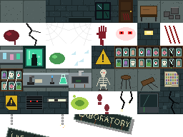
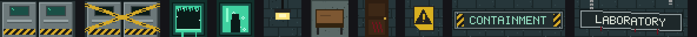
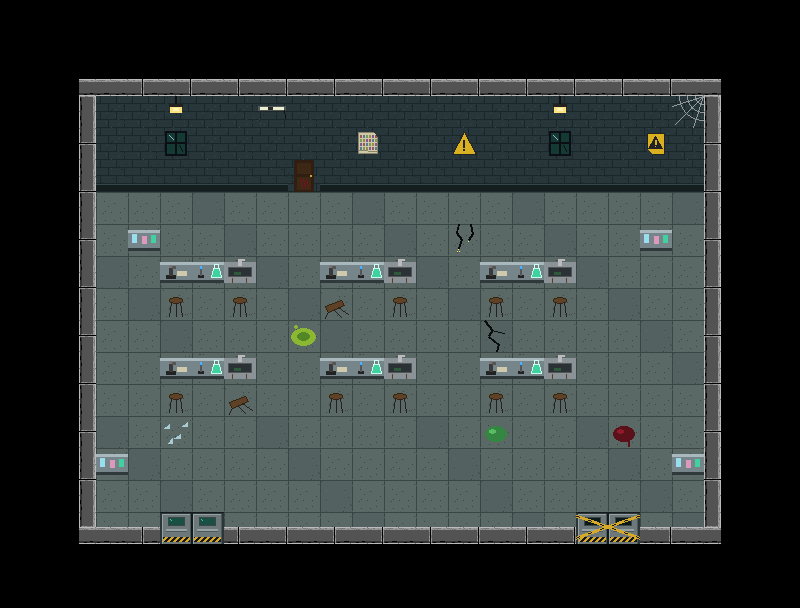
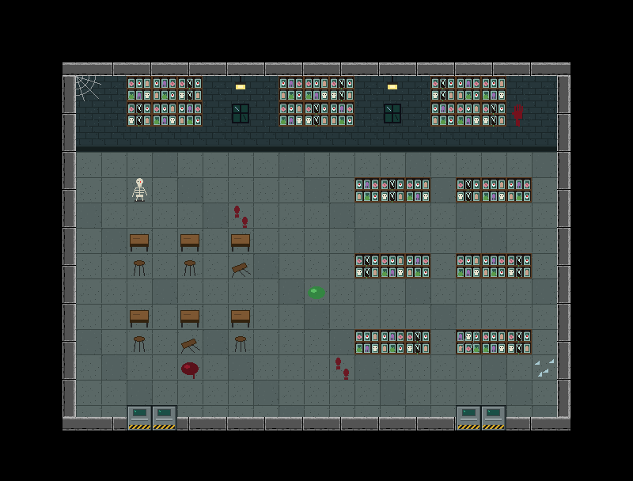
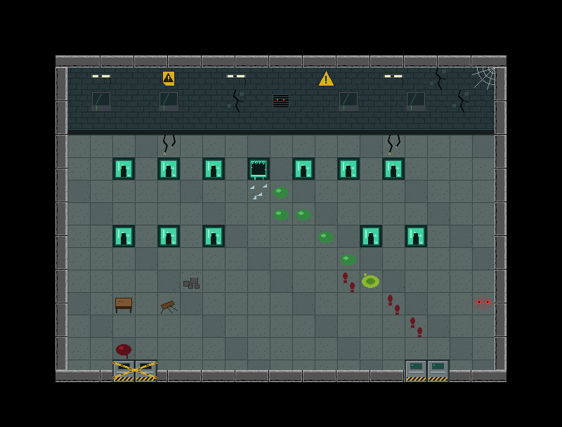
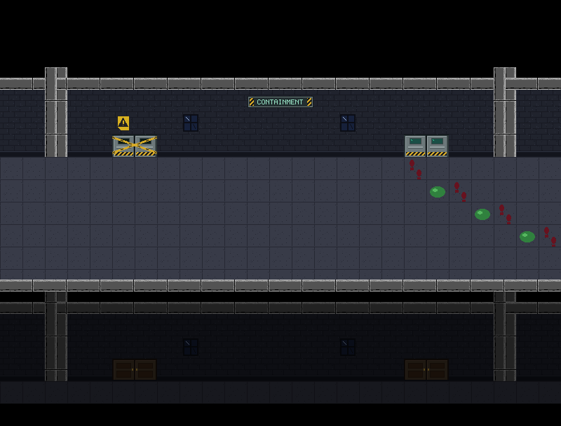
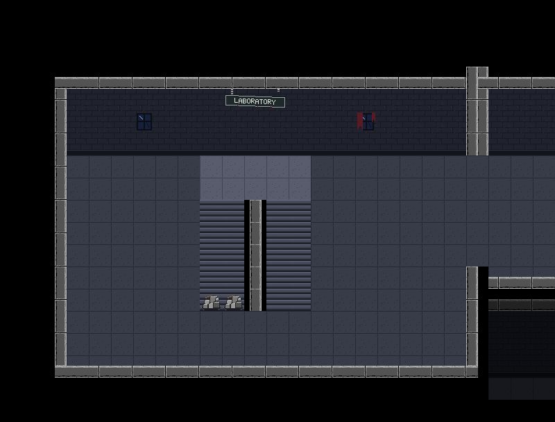

# Floor 2: The Labs — a step-by-step guide

This guide follows on from [`floor3-library-guide.md`](floor3-library-guide.md). Here's what was added:

- **Floor 2**, reached by going down the west stairs from Floor 3.
- **Three labs** (Chemistry, Biology, Containment), each a single screen behind its own part of the hallway.
- **51 new tiles** from your lab sheet: cut out, plus new lab doors, a smashed pod, name plaques and a LABORATORY sign.
- **Two clean-ups that make the code more general:** one shared character-map painter for the library and the labs, and one place that knows every kind of door.
- **A safety check** that catches a broken door link when the game starts, instead of crashing during play.

---

## The big picture

```
Floor 4   [West Stairs]<->[Hallway 402]<->[Hallway 403]<->[Hallway 404]<->[East Stairs]
                |                (classrooms behind)
Floor 3   [West Stairs]<->[Hallway]<->[Hallway Entrance]<->[Hallway]<->[East Stairs]
                |                (the library behind, 3 screens)
Floor 2   [West Stairs]<->[Hallway Chem]<->[Hallway Bio]<->[Hallway Containment]<->[East Stairs]
                               |               |                  |
                        [Chemistry Lab]  [Biology Lab]    [Containment Lab]
```

The floor list is now three long: `floor4.below == floor3`, `floor3.below == floor2`. Every floor has the same 5-screen hallway, so the stairwells stack exactly on top of each other.

---

## Step 1 — Reading the lab sheet



It's 8 × 6 tiles. Four things stood out.

**1. Same drawings, new colours, again.** Like the library sheet, the floor and brick are the classroom tiles' drawings recoloured. This time the colours are **cool teal and grey-green**:

| | Most common colour |
|---|---|
| Building floor (classroom tiles) | `(56, 59, 72)`: blue-grey |
| Lab floor | `(90, 104, 102)`: grey-green |
| Lab brick | `(38, 54, 58)`: dark teal |

That's close to the building's own cool palette, so the labs fit Floor 2's hallway naturally. That's also good storytelling: a clinical, colder wing after the warm library.

**2. The horror decals are identical to the library's.** I compared every pixel of the blood, crack, cobwebs, handprint, eyes and scratches: they're exact copies. So the labs **reuse** the existing tiles (`BLOOD_SPLAT` and so on) instead of loading duplicates.

**3. A correction: the lamp, table, boxes and bloody door.** When this guide was first written, it said these four were exact copies of the library's tiles, with the library's warm brown background still drawn in. That was wrong. The comparison code had a bug (see the box below). Each sheet's versions really have that sheet's own background, so the lab's four tiles were fine as they were.

> **The bug, and the lesson.** The comparison used Pillow's `getbbox()` on the difference between two images. On images with transparency, `getbbox()` only looks at the **alpha (transparency) channel** by default, so two fully opaque tiles with completely different colours looked "identical". The fix was to compare every byte of every pixel (`a.tobytes() == b.tobytes()`). That confirmed the six see-through decals really are identical, but the lamp, table, boxes and door are not. The mistake was found while starting Floor 1. **The game was never affected:** the "recolour" step only changed pixels in the library's colours, so it changed nothing, and the four files are byte-for-byte the lab sheet's own tiles. **Lesson:** when a check gives a surprising answer, check the checker. Here the giveaway was a tile reported "identical" whose colours were obviously different.

**4. The "LABORATORY" signs were cut off.** As with the QUIET signs, neighbouring tiles overlap them: one lost its bottom, the other the tops of its letters. A complete one was drawn instead.

---

## Step 2 — Making the tiles

**Folder:** `src/main/resources/tiles/lab/` (51 files)

### Cut straight from the sheet (33 tiles)

The floor, wall, window, lamp, table, boxes, bloody door, specimen shelves, the three lab bench pieces (microscope, burner, sink, which join into one 3-tile bench), the skeleton, stools, pods, hazard signs, vent, lights, monitor, slime, puddle, footprints, glass and wires.

### The flood fill

A **flood fill** works like the paint-bucket tool in Aseprite:

1. Start at every pixel on the tile's edge.
2. If the pixel is a background colour, change it, then spread to its 4 neighbours.
3. Stop at any pixel that isn't a background colour, such as an object's outline.

The fill spreads through the background around an object but never gets inside it.

### Cut out (1 tile): a hazard sign for the hallway

The hazard signs have teal bricks behind them, which would clash on the hallway's blue-grey wall. A flood fill that turns the brick pixels **transparent** produced `hazard_decal.png`: just the sign, usable on any wall.

### Drawn new (17 tiles)



| Art | Tiles | Notes |
|---|---|---|
| Steel lab door | 2 | windows, push bars, hazard stripes along the bottom |
| Sealed lab door | 2 | the same door, dark windows, caution tape in an X |
| Smashed pod | 1 | the sheet's pod, with jagged glass left round the edge, empty inside, liquid leaking out |
| CHEMISTRY / BIOLOGY / CONTAINMENT plaques | 3 each | steel and mint; CONTAINMENT has hazard stripes |
| LABORATORY sign | 3 | hanging crooked from its one remaining chain |

**How the sign hangs crooked:** it's drawn straight first, then **sheared**. Every column of pixels is moved down by `x / 24` pixels (0 on the left, 3 on the right), so the right end droops. It's the same "stepped" look as the sheet's own crooked sign. The pixel font from the library gained the letters C, G, H, M, N, O and S.

---

## Step 3 — One character-map painter for everything

**Files:** [`MapBuilder.java`](../src/main/java/nightmare404/tile/MapBuilder.java) (`paint`, `Underlay`), [`Library.java`](../src/main/java/nightmare404/map/Library.java), [`Lab.java`](../src/main/java/nightmare404/map/Lab.java)

The library had its own `paint()` method for reading character maps. The labs need exactly the same thing with a different legend and different wall/floor tiles. Copying the method would mean fixing every future bug twice, so it moved into `MapBuilder`, where any room can use it:

```java
public MapBuilder paint(String[] map, Map<Character, Integer> legend, Underlay underlay)
```

It takes three inputs:

**1. The map**: the 18 strings, as before.

**2. The legend, now a `Map`** instead of a `switch`. A `Map` is a lookup table from keys to values, here from a character to a tile ID:

```java
private static final Map<Character, Integer> LEGEND = Map.ofEntries(
        Map.entry('O', CONTAINMENT_POD),
        Map.entry('Q', POD_BROKEN),
        Map.entry('g', SLIME),
        ...);
```

`legend.get('O')` gives `CONTAINMENT_POD`. A character that isn't in the table gives `null`, which `paint` turns into a clear error message.

**3. The underlay**: the code that decides what goes *under* each character. Each room has its own (brick or tiled wall, wood or lab floor), so it's passed in as an **interface**:

```java
public interface Underlay {
    int tileAt(int col, int row);
}
```

An interface is a promise: "whatever you give me has a `tileAt(col, row)` method". The library and the labs keep it simple by pointing at a method they already have:

```java
b.paint(map, LEGEND, Lab::underlay);
```

`Lab::underlay` is a **method reference**: it means "use `Lab`'s `underlay` method as the `Underlay`". Now `paint` can ask any room "what's under column 5, row 9?" without knowing which room it is.

**Proof it changed nothing:** after the move, every library screen was compared with the pictures from before. They're pixel-identical.

---

## Step 4 — One place that knows every kind of door

**Files:** [`TileSet.java`](../src/main/java/nightmare404/tile/TileSet.java) (`doorSize`), [`TileMap.java`](../src/main/java/nightmare404/tile/TileMap.java), [`Hallway.java`](../src/main/java/nightmare404/map/Hallway.java) (`copyDoors`)

There are now three kinds of door: the classroom door, the big library door and the steel lab door. Instead of an `if` for each kind inside `TileMap`, there's one lookup in `TileSet`:

```java
public static int[] doorSize(int id) {
    if (id == DOOR_LEFT || id == LAB_DOOR_L) return new int[] {2, 1};
    if (id == BIG_DOOR_TL) return new int[] {4, 2};
    return null;
}
```

`TileMap` just asks "does this tile start a door, and how big is it?". **Adding the lab door was one word in this method**; nothing else had to change to make it work.

### The hallway copies doors from the room's map

Before, the hallway copied the doors from a classroom's *number grid*. The labs are character maps, so that no longer worked. Now it reads them from the finished map of any room, using a small getter, `TileMap.tileAt(layer, col, row)`:

```java
int id = room.tileAt(LAYER_OBJECTS, col + half, Classroom.DOOR_ROW);
b.set(LAYER_OBJECTS, col + half, BASE_ROW, id);
if (!tiles.isSolid(id)) {
    b.set(LAYER_FLOOR, col + half, BASE_ROW, FLOOR);   // a working door needs walkable floor under it
}
```

It no longer checks for specific door tiles either. It asks `isSolid`, so it works for classroom doors, broken doors, lab doors and sealed doors alike.

---

## Step 5 — The three labs

**File:** [`Lab.java`](../src/main/java/nightmare404/map/Lab.java)

Each lab has the **same shape as a classroom**: side walls at columns 2 and 22, and doors in the bottom wall at columns 5–6 and 18–19. That's what makes them line up with the hallway. The frame code leaves the bottom wall open wherever the map has a door character.

### Legend

| Char | Tile | Char | Tile | Char | Tile |
|---|---|---|---|---|---|
| `.` | lab floor | `w` | tiled wall | `_` | wall base |
| `D` `d` | lab door | `Z` `z` | sealed door | `X` | locked bloody door |
| `W` | window | `L` | lamp | `F` | broken light |
| `A` | hazard triangle | `Y` | hazard sign | `P` | periodic table |
| `V` | vent with eyes | `M` | cracked monitor | `/` | cracked wall |
| `1` `2` `3` | specimen shelves | `4` | smashed shelf | `R` | reagent shelf |
| `m` `u` `n` | lab bench (3 pieces) | `S` | skeleton | `t` | table |
| `h` | stool | `H` | knocked-over stool | `x` | boxes |
| `O` | containment pod | `Q` | smashed pod | `e` | glowing eyes |
| `g` | slime | `G` | toxic puddle | `f` | footprints |
| `i` | broken glass | `r` | dangling wires | `*` `~` | blood, crack |
| `!` | handprint | `c` | claw marks | `<` `>` | cobwebs |

### Chemistry Lab

Three rows of lab benches with stools (some knocked over), reagent shelves in the corners, the periodic table and hazard signs. Its right-hand door is **sealed**.



### Biology Lab

Walls of specimen jars, freestanding specimen shelves, dissection tables and the skeleton. Both doors work.



### Containment Lab: a story told with tiles

Two rows of containment pods. One in the top row is **smashed from the inside**. From it, broken glass, then slime, then **bloody footprints** lead across the room to the door. The left door is sealed with a hazard sign above it, and something with red eyes watches from behind the wall vent and from the corner.



There's no text and no code behaviour: just where the tiles are placed. The player works out "something got out" by themselves.

---

## Step 6 — Floor 2's hallway

`Hallway.labFront(...)` builds each screen like Floor 4's classroom hallway (pillars between rooms, doors copied from the lab), plus:

- **a name plaque** in the middle of the wall (CHEMISTRY, BIOLOGY, CONTAINMENT), so the player knows what's behind each door;
- **a hazard sign over every sealed door**;
- **the trail continues:** outside the Containment Lab, the footprints and slime carry on out of the door and along the corridor towards the collapsed east stairs.



The crooked LABORATORY sign hangs over the stairs, the first thing you see on arriving. `Stairs.west` gained an optional last parameter for a wall sign:

```java
public static TileMap west(TileSet tiles, int ts, boolean leadsDown, boolean leadsUp, int... wallSign)
```

The `...` (**varargs**) means "any number of these, including none". Floors 3 and 4 pass nothing, so they're unchanged; Floor 2 passes the sign's three tile IDs.



---

## Step 7 — Linking the third floor

In `World`:

```java
Room westStairs3 = floor3.append("West Stairs", Stairs.west(tiles, ts, true, true));   // now goes both ways
...
Room westStairs2 = floor2.append("West Stairs", Stairs.west(tiles, ts, false, true, <LABORATORY sign>));
...
Floor.connectStairs(floor4, floor3);
Floor.connectStairs(floor3, floor2);
```

The rubble on Floor 3's down flight is gone, because there's now somewhere to go. Floor 2's own down flight was blocked at first; it opened when Floor 1 was built (see [`floor1-ground-guide.md`](floor1-ground-guide.md)).

**No new stairs code was needed.** `Player.checkStairs()` already follows `floor.below` and `floor.above`, whatever floor it's on. Walking from Floor 4 down to Floor 2 is just following two links in the floor list.

---

## Step 8 — A bug, and a safety net

The first test run found a real bug. In all three lab maps, the right-hand door pair was at columns **17–18** instead of **18–19**: the bottom row had one dot too few between the doors. Two things went wrong:

1. The hallway copies doors from columns 18–19, so it only got *half* a door, and walking into it did nothing.
2. On the Containment hallway, the result was **no working door at all**. Walking out of the lab then crashed the game (`NullPointerException`), because `goThroughDoor` asked the hallway for a door to arrive at and got nothing back.

**The fix:** put the doors in the right columns (11 dots between the pairs, not 10).

**The safety net:** a mistake like this should never get as far as a crash during play. `Floor.addRoomBehind` now checks, while the world is being built, that **both** rooms linked by a door really have one:

```java
if (map.nearestDoor(0) == null) {
    throw new IllegalStateException(name + " is linked to " + hallway.name + " but its map has no working door");
}
```

If a future map has this problem, the game won't even start, and the message says exactly which room is wrong. A test confirmed it: linking a doorless room is refused with *"Doorless room is linked to Hallway (Biology Lab) but its map has no working door"*.

**The lesson:** check your assumptions where the data is created, not where it's used. The earlier the error, the easier it is to understand.

---

## Step 9 — Testing

A new simulated play-through (38 checks):

| Area | Checks |
|---|---|
| Floor links | 4 ↔ 3 ↔ 2; walking the floor list visits 3 floors |
| Stairs | Floor 3 → 2 and back, arriving at the right foot; Floor 2's down flight blocked; Floor 4 → 3 → 2 in one go |
| Hallway | west stairs → Chemistry → Biology → Containment → east stairs; the end wall stops you |
| Lab doors | all 6 door positions, from both sides: the 4 working doors go in and out at the matching door, and the 2 sealed doors block from both sides |
| Inside | labs are single fixed screens; benches and pods are solid; the slime and glass trail can be walked over |
| Lists | 5 hallway screens, every back link correct, every lab door linked both ways |

Plus:
- **Floors 4 and 3 are pixel-identical** to before; the only difference is the intended one, the rubble removed from Floor 3's down flight.
- **The library is pixel-identical** after the move to the shared painter.
- **All earlier tests pass**, and the safety check refuses a doorless room.

---

## What changed, file by file

| File | Change |
|---|---|
| `src/main/resources/tiles/lab/` | **new**: 51 tiles (33 cut, 1 cut out, 17 drawn) |
| `docs/images/lab_sheet.png` | your original sheet, kept for reference |
| `src/main/java/nightmare404/map/Lab.java` | **new**: the three labs as character maps |
| `src/main/java/nightmare404/tile/TileSet.java` | IDs 100–150; `doorSize()` |
| `src/main/java/nightmare404/tile/MapBuilder.java` | `paint(map, legend, underlay)` and the `Underlay` interface (moved from `Library`) |
| `src/main/java/nightmare404/map/Library.java` | uses the shared `paint`; legend is now a `Map` |
| `src/main/java/nightmare404/tile/TileMap.java` | finds doors via `doorSize`; `tileAt()` getter |
| `src/main/java/nightmare404/map/Hallway.java` | `outside` takes the room's map; new `labFront`; shared `copyDoors` |
| `src/main/java/nightmare404/map/Stairs.java` | optional wall sign (`int... wallSign`) |
| `src/main/java/nightmare404/world/Floor.java` | `addRoomBehind` checks both rooms have a working door |
| `src/main/java/nightmare404/world/World.java` | builds Floor 2; Floor 3's stairs go both ways; classroom maps are built before their hallways |

---

## Editing the labs

1. Change characters in `CHEMISTRY`, `BIOLOGY` or `CONTAINMENT` in `Lab.java`. Every line must be 25 characters.
2. Doors must stay at **columns 5–6 and 18–19** of row 16 (`D d` for a working door, `Z z` for sealed). Count carefully; if they're wrong, the game now tells you at start-up.
3. Keep row 15 clear in front of every working door, so the player has somewhere to arrive.
4. To unseal a door, change its `Z z` to `D d`. The hallway copies it automatically.

---

## Next steps

- **Hazards that hurt:** a `damaging` list in `TileSet`, like `WALKABLE`, and the toxic puddles and slime could drain health. This would be the first real use of the HP bar.
- **Opening the sealed doors:** a keycard found somewhere (the library?) that turns a sealed door into a working one. Change the tiles, then call `map.clearCache()`.
- **Something in the pod's trail:** the footprints lead to the collapsed east stairs. That's a natural place for whatever escaped to be waiting.
- ~~**Floor 1**~~: done, see [`floor1-ground-guide.md`](floor1-ground-guide.md).
