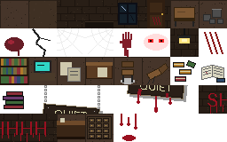
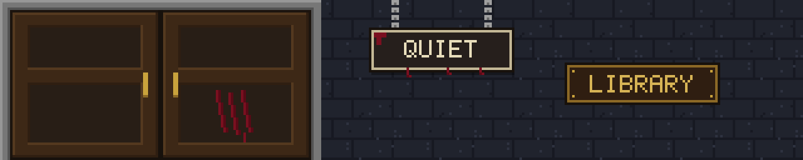
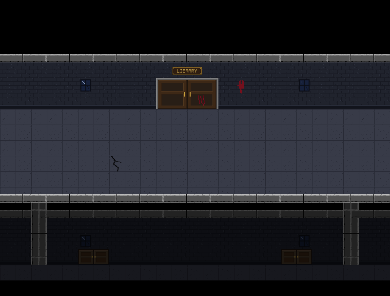
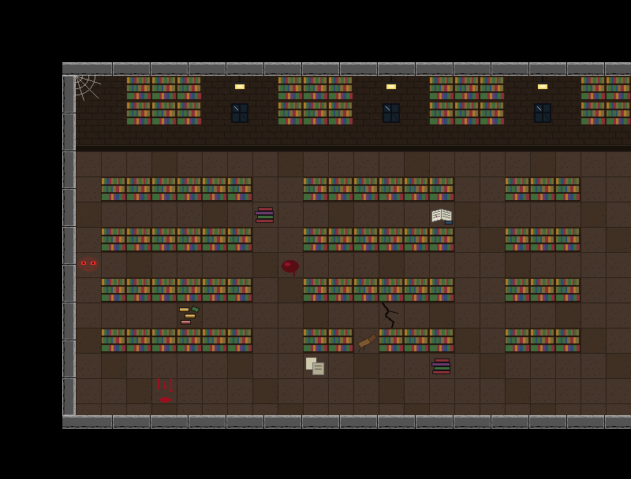
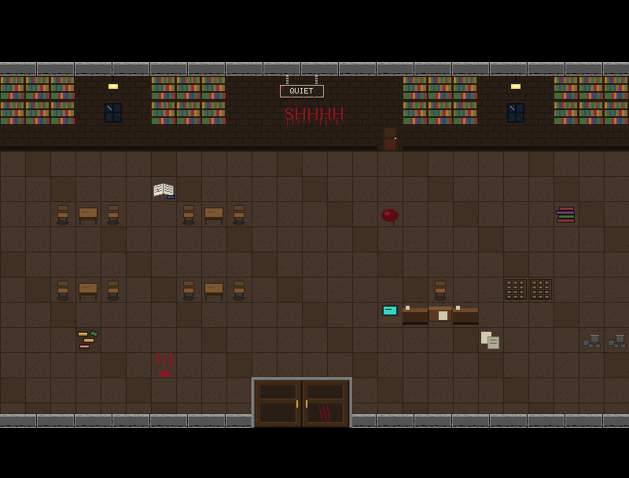
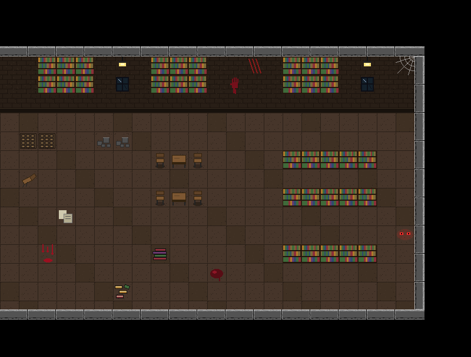
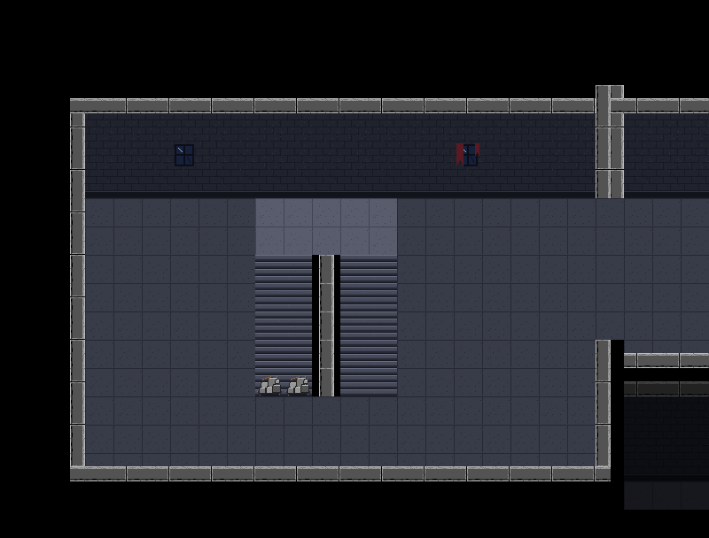

# Floor 3: Working Stairs and the Library — a step-by-step guide

This guide follows on from [`hallway-guide.md`](hallway-guide.md), which explains tiles, maps and the linked list. Here's what was added:

- **Working stairs.** The west stairs on Floor 4 take you down to a new **Floor 3**, and back up.
- **Floor 3's hallway**, built like Floor 4's so the two floors line up.
- **The library**: one big room, three screens wide, shown **screen by screen** (no scrolling). The only way in is a **big double door** in the middle of the hallway.
- **43 new tiles**: 31 cut from your library sheet, plus a big double door (8 tiles), a QUIET sign and a LIBRARY plaque (2 tiles each), all drawn to match.

---

## The big picture

```
Floor 4   [West Stairs]<->[Hallway 402]<->[Hallway 403]<->[Hallway 404]<->[East Stairs]
                |               |               |               |
                |           [Room 402]      [Room 403]      [Room 404]   <- you start here
                |
                |  stairs: floor4.below == floor3, floor3.above == floor4
                |
Floor 3   [West Stairs]<->[Hallway]<->[Hallway Entrance]<->[Hallway]<->[East Stairs]
                                             |  big double door
                          [Library W]<->[Library Entrance]<->[Library E]
```

Three kinds of links are now in use:

| Link | Connects | Example |
|---|---|---|
| `left` / `right` | screens side by side | the hallway; **and now the 3 library screens** |
| `door` | a hallway screen and the room behind it | Hallway Entrance ↔ Library Entrance |
| `above` / `below` | whole floors, through the stairs | Floor 4 ↔ Floor 3 |

---

## Step 1 — Reading your sheet



The sheet is 256 × 160 pixels: 8 × 5 tiles of 32 px. Before using it, I looked at every tile and found two things that shaped the design.

**1. Some pieces were cut off.** Both "QUIET" signs (middle of the sheet) overlap their neighbours: one lost its bottom half and the other lost its top half. Neither could be used as it was, so I drew a complete QUIET sign in the same style (Step 2).

**2. The walls and floor are your classroom tiles in a different colour.** The brick pattern, the base band and the speckled floor are the *same drawings* as `02_wall`, `03_wall_base` and `01_floor`, but warm brown instead of cool blue-grey. That answered "how do I make it fit without looking too separate":

- **Inside the library:** keep the warm brown floor and bricks. Most of the sheet's furniture has that brown floor drawn into it, so it matches perfectly. The room is then framed with **the same grey stone wall strips** as every other room, so it clearly belongs to the same building: an older, lamp-lit, wooden-floored wing.
- **Floor 3's hallway:** exactly the same cool style as Floor 4. Only see-through decorations go there (handprint, scratches, cobweb, blood, crack), because the sheet tiles with brown brick drawn in would clash with the cool walls.
- You only pass between the warm and cool palettes through the big door, which cuts to a new screen, so they never appear side by side.

---

## Step 2 — Cutting tiles and drawing new ones

**Folder:** `src/main/resources/tiles/library/` (43 files)

A script cut 31 tiles out of the sheet and saved each one as its own 32 × 32 PNG with a descriptive name (`bookshelf.png`, `card_catalog.png`, `blood_writing_1.png` and so on).

It also **drew** 4 new pieces, pixel by pixel, using colours sampled from the sheet's door and from your stone wall strips:



| New art | Size | Notes |
|---|---|---|
| Big double door | 128 × 64 → 8 tiles (`big_door_0`–`7`) | stone frame like the wall strips, two wooden leaves, brass handles, bloody claw marks |
| QUIET sign | 64 × 32 → 2 tiles | hangs on chains, blood smear and drips |
| LIBRARY plaque | 64 × 32 → 2 tiles | wood and gold, goes above the door in the hallway |

The letters are a tiny 5 × 7 pixel font typed out as patterns of `#` and `.`, like this "Q":

```
.###.
#...#
#...#
#...#
#.#.#
#..#.
.##.#
```

All of these are ordinary PNG files. You can redraw any of them in Aseprite; keep the file name and size and the game uses your version.

---

## Step 3 — Registering the tiles (`TileSet`)

**File:** [`src/main/java/nightmare404/tile/TileSet.java`](../src/main/java/nightmare404/tile/TileSet.java)

The new tiles get IDs **57–99**, after the stairs (51–56):

| IDs | What |
|---|---|
| 57–87 | tiles cut from the sheet (`LIB_FLOOR_1`, `BOOKSHELF`, `BLOOD_SPLAT`, ...) |
| 88–91 | QUIET sign and LIBRARY plaque (left and right halves) |
| 92–99 | the big double door: `BIG_DOOR_TL` (top-left) and the 7 pieces after it in reading order |

They're loaded the same way as the stair tiles: a list of file names in the same order as the IDs, and a loop:

```java
for (int i = 0; i < LIBRARY_FILES.length; i++) {
    images[LIB_FLOOR_1 + i] = load(LIBRARY_DIR + LIBRARY_FILES[i]);
}
```

### Solid or walkable: decorations

Things painted **on the floor** (blood, papers, cracks, an open book, scattered books) are added to the `WALKABLE` list, so you can walk over them. The same decorations painted **on a wall** still block, because the wall tile underneath is solid, and a cell is solid if *any* tile on it is solid. One rule covers both cases.

---

## Step 4 — The big double door

### Placing it: `MapBuilder.bigDoor(col, row, floorUnder)`

```java
for (int r = 0; r < 2; r++) {
    for (int c = 0; c < 4; c++) {
        layers[LAYER_FLOOR][row + r][col + c] = floorUnder;       // walkable floor under the door
        layers[LAYER_WALLS_H][row + r][col + c] = EMPTY;          // remove any wall strip there
        layers[LAYER_OBJECTS][row + r][col + c] = TileSet.BIG_DOOR_TL + r * 4 + c;
    }
}
```

`BIG_DOOR_TL + r * 4 + c` picks the right piece: row 0 gets IDs 92, 93, 94, 95 and row 1 gets 96, 97, 98, 99. It's the same "row × width + column" trick used to number any grid.

> **Updated on Floor 2:** the door check below became a one-line lookup, `TileSet.doorSize(id)`. See [`floor2-lab-guide.md`](floor2-lab-guide.md), Step 4.

### Finding it: `TileMap`

Before, a door was always "`DOOR_LEFT` followed by `DOOR_RIGHT`" (2 × 1). Now there are two kinds:

```java
if (id == TileSet.DOOR_LEFT && ... next is DOOR_RIGHT) {
    addDoorIfWalkable(col, row, 2, 1);      // normal door
} else if (id == TileSet.BIG_DOOR_TL) {
    addDoorIfWalkable(col, row, 4, 2);      // big double door
}
```

`addDoorIfWalkable` checks every cell of the door. As before, a door painted on a solid wall is just decoration.

### Going through it

**Nothing in `Player` had to change.** The code from Floor 4 already used the door's own size:

```java
x = door.x + door.width / 2 - size / 2;                    // centred on the door, whatever its width
y = door.y + door.height - solidOffsetY + 2;               // below the door, whatever its height
```

That's a good sign that code is general: something new (a bigger door) works without touching it.



---

## Step 5 — The library, written as character maps

**File:** [`src/main/java/nightmare404/map/Library.java`](../src/main/java/nightmare404/map/Library.java)

The classrooms use grids of numbers. With 30+ different tiles and IDs up to 99, a number grid becomes hard to read, so each library screen is written as a **character map**: 18 lines of 25 characters, one character per tile.

```java
"   <wBBBwLwBBBwLwBBBwLwBB",    <- back wall: cobweb, bookcases, lamps
"   wwBBBwWwBBBwWwBBBwWwBB",    <- ...windows under the lamps
"   ______________________",    <- wall base
"   ......................",
"   .BBBBBB..BBBBBB..BBB..",    <- a row of bookshelves
"   .......s......o.......",    <- an aisle with a pile of books and an open book
```

You can *see* the room in the code. The **legend** says what each character means:

| Char | Tile | Char | Tile | Char | Tile |
|---|---|---|---|---|---|
| `.` | wooden floor | `w` | brick wall | `_` | wall base |
| `B` | bookshelf | `W` | window | `L` | wall lamp |
| `X` | locked bloody door | `S` `H` `h` | blood writing "SHHHHH" | `q` `Q` | QUIET sign |
| `<` `>` | cobwebs | `m` | claw marks | `!` | handprint |
| `c` | chair | `t` | table | `C` | computer desk |
| `k` | counter | `f` | front desk | `K` | card catalogue |
| `x` | boxes | `n` | broken bench | `s` | pile of books |
| `e` | glowing eyes | `p` | papers | `o` | open book |
| `b` | scattered books | `*` | blood | `%` | blood drips |
| `~` | crack | ` ` (space) | void | | |

### How a character map becomes tiles

`paint()` reads every character and does two things:

1. **Puts something underneath**, chosen by the **row**: brick wall on rows 3–4, the wall base on row 5, wooden floor below that (`underlay()`).
2. **Puts the character's tile on top** (the legend says which tile).

```java
b.set(LAYER_FLOOR, col, row, underlay(col, row));
int object = objectFor(ch, col, row);
if (object != EMPTY) b.set(LAYER_OBJECTS, col, row, object);
```

A bookcase on the wall and a bookshelf in the middle of the room use the same `B`. Only what's underneath differs, and the row decides that automatically.

**Two floor tiles, no visible grid:** the sheet has two floor variants. `underlay()` mixes them with `(col * 7 + row * 3) % 5 == 0`, a simple formula that scatters variant 2 irregularly, so the floor doesn't look like a checkerboard.

> **Updated on Floor 2:** this code was later moved into a shared `MapBuilder.paint(map, legend, underlay)`, and the legend became a `Map` instead of a `switch`. The idea is the same; see [`floor2-lab-guide.md`](floor2-lab-guide.md), Step 3.

### Safety checks

If a line has the wrong length, or uses a character that isn't in the legend, the game stops immediately with a clear message, for example `Library map row 7 has 24 characters, not 25` or `Unknown library map character 'z' at column 5, row 9`. Failing loudly is better than a room that silently looks wrong.

### The stone frame

`frame()` adds the grey wall strips, like every other room: a top and bottom wall on all three screens, and side walls **only at the two ends** (column 2 on the west screen, column 22 on the east screen). There are no walls where the screens meet, because it's one room.

### The three screens

**West: the stacks.** Rows of bookshelves with narrow aisles, and something watching from the corner.


**Entrance.** Reading tables, the librarian's desk with a computer and card catalogue, the QUIET sign above "SHHHHH" in blood, a locked staff door, and the big door.


**East: the archive.** Card catalogues, storage boxes, a reading corner, claw marks and a handprint on the wall.


### Editing the library yourself

1. Open `Library.java` and change characters in `WEST`, `ENTRANCE` or `EAST`. Keep every line exactly 25 characters.
2. Keep a path to the door clear (rows 13–15 around columns 10–13 on the entrance screen).
3. Keep the screen edges open where screens join (column 24 of the west screen, columns 0 and 24 of the entrance, column 0 of the east screen), or the player can't cross.
4. To add a new decoration, add a tile to `TileSet`, pick an unused character, and add one entry to the `LEGEND` map.

---

## Step 6 — Floor 3's hallway

**File:** [`src/main/java/nightmare404/map/Hallway.java`](../src/main/java/nightmare404/map/Hallway.java)

Floor 3's hallway shares almost everything with Floor 4's, so that shared part became one method, `corridorScreen()`: the front wall, the corridor, the railing and the floor below. Each kind of hallway then adds its own details:

| Method | Adds |
|---|---|
| `outside(...)` (Floor 4) | pillars between classrooms, the classroom's doors, windows |
| `libraryFront(..., part)` (Floor 3) | pillars **only at the library's ends**, windows, and on the middle screen the big door and the LIBRARY plaque |

The library front has no pillars in the middle because the library is one room. From the hallway you can see it's one long wall, which tells the player there's only one way in.

This is called **refactoring**: changing how code is organised without changing what it does. To prove nothing changed, I compared every Floor 4 screen with the pictures from before. They're **pixel-identical**, apart from the one intended change on the stairs (Step 8).

---

## Step 7 — A room wider than one screen

**Files:** [`src/main/java/nightmare404/world/Floor.java`](../src/main/java/nightmare404/world/Floor.java), [`src/main/java/nightmare404/world/Room.java`](../src/main/java/nightmare404/world/Room.java), [`GamePanel.java`](../src/main/java/nightmare404/main/GamePanel.java), [`Player.java`](../src/main/java/nightmare404/entity/Player.java)

### Linking the three screens

The library is its **own small linked list**, separate from the hallway list:

```java
Room libraryEntrance = floor3.addRoomBehind("Library (Entrance)", ..., hallEntrance);  // door link
Room libraryWest = floor3.addLeftOf(libraryEntrance, "Library (West)", ...);          // left/right links
Room libraryEast = floor3.addRightOf(libraryEntrance, "Library (East)", ...);
```

`addLeftOf` links two nodes in both directions:

```java
Room room = new Room(name, this, map);
room.right = existing;     // new room -> existing
existing.left = room;      // existing -> new room
```

It refuses (throws an error) if something is already there, so you can't accidentally lose a link.

Only the entrance has a `door` link, so there's only one way in or out, which is exactly what you asked for.

### Screen by screen: `fixedScreen`

The hallway scrolls, but the library should cut from screen to screen like the classrooms. Rooms now have a flag:

```java
public boolean fixedScreen = false;   // true for the 3 library screens
```

and the camera checks it first:

```java
if (currentRoom.fixedScreen) return 0;   // never scrolls
```

Walking off the edge of a library screen uses the **same** left/right code as the hallway. Without the scrolling, it shows up as a cut to the next screen.

### A bug found by the tests

At first, after crossing into a fixed screen, the game moved the player so they were fully on screen. That's needed because they arrive half outside the edge. But the code ran **every frame**, so the player could never get close enough to the edge to cross it: they were pushed back every frame. The tests caught it ("walking off the left edge" failed). The fix was to only do it **on the frame you arrive**:

```java
if (changedRoom && room.fixedScreen) {
    x = Math.max(0, Math.min(x, gp.screenWidth - size));
}
```

**The lesson:** "fix it up after X happens" must check that X actually happened.

---

## Step 8 — Stairs that take you to another floor

**Files:** [`src/main/java/nightmare404/tile/Staircase.java`](../src/main/java/nightmare404/tile/Staircase.java), [`src/main/java/nightmare404/map/Stairs.java`](../src/main/java/nightmare404/map/Stairs.java), [`Player.java`](../src/main/java/nightmare404/entity/Player.java)

### The rule

```
     [ down zone ][rail][ up zone ]     <- the landing
     [ left      ][rail][ right   ]
     [ flight    ][rail][ flight  ]
       ^ downFoot         ^ upFoot
```

- Walk up the **left** flight onto the landing → you go **down** a floor.
- Walk up the **right** flight onto the landing → you go **up** a floor.
- You arrive **at the foot of the flight that leads back** on the other floor. Go down from Floor 4 and you appear at the bottom of Floor 3's "up" flight, so walking straight back up returns you.



### `Staircase`: the data

A small class with four values: two zones (rectangles on the landing) and two arrival points:

```java
public final Rectangle downZone, upZone;
public final Point downFoot, upFoot;
```

`Stairs.west(...)` creates it while building the map, and the `TileMap` keeps it in `map.stairs` (`null` on maps without working stairs).

### `Player`: using it

```java
if (floor.below != null && stairs.downZone.intersects(solidArea)) {
    arriveOnStairs(floor.below, true);
}
```

`arriveOnStairs` follows the **floor link** (`floor.below`), then that floor's `stairs` room, then that room's `Staircase`, and places the player at the right foot. That's three links in a row.

### Linking the floors

```java
Floor.connectStairs(floor4, floor3);   // floor4.below = floor3; floor3.above = floor4;
```

It's the same idea as linking rooms, one level up: a list of floors, where each floor is a list of rooms.

### Flights that lead nowhere (yet)

There's no Floor 5 (and at first there was no Floor 2), so those flights are blocked with **rubble across the bottom step**, the only way onto a flight:

```java
Stairs.west(tiles, ts, true, false)    // Floor 4: leads down, not up
Stairs.west(tiles, ts, false, true)    // Floor 3: leads up, not down
```

When Floor 2 was built, Floor 3's became `(true, true)`, and `Floor.connectStairs(floor3, floor2)` linked them: see [`floor2-lab-guide.md`](floor2-lab-guide.md).

---

## Step 9 — Testing

Simulated play with key presses:

| Check | Result |
|---|---|
| `floor4.below == floor3`, `floor3.above == floor4` | ✅ |
| Floor 4 left flight → Floor 3, at the foot of the up flight | ✅ |
| Floor 3 right flight → Floor 4, at the foot of the down flight | ✅ |
| Flights to missing floors are blocked by rubble | ✅ |
| Floor 3 hallway: only the middle screen has a way in | ✅ |
| Big door → Library (Entrance), arriving above the door | ✅ |
| Library: camera stays at 0 on all 3 screens | ✅ |
| Library: West ↔ Entrance ↔ East by walking off the edges, player fully on screen | ✅ |
| Library's outer walls stop you; no exit through the side screens' bottom wall | ✅ |
| Big door back out → hallway, camera scrolls again | ✅ |
| Linked lists: hallway order, library row both ways, door both ways | ✅ |
| Floor 4: every screen pixel-identical (except the intended rubble), all old tests pass | ✅ |

Run `MapPreviewDebug` to print both floors and save a picture of all 16 screens:

```
Floor 4 (5 hallway screens):
  West Stairs
  Hallway (Room 402)
      door -> Room 402
  ...
Floor 3 (5 hallway screens):
  West Stairs
  Hallway (Library West)
  Hallway (Library Entrance)
              Library (West)
      door -> Library (Entrance)
              Library (East)
  Hallway (Library East)
  East Stairs (collapsed)
```

---

## What changed, file by file

| File | Change |
|---|---|
| `src/main/resources/tiles/library/` | **new**: 43 tiles (31 cut from the sheet, 12 drawn) |
| `docs/images/library_sheet.png` | your original sheet, kept for reference |
| `src/main/java/nightmare404/map/Library.java` | **new**: the 3 library screens as character maps |
| `src/main/java/nightmare404/tile/Staircase.java` | **new**: stair zones and arrival points |
| `src/main/java/nightmare404/tile/TileSet.java` | IDs 57–99; decorations on the floor are walkable |
| `src/main/java/nightmare404/tile/TileMap.java` | finds big doors; holds `stairs` |
| `src/main/java/nightmare404/tile/MapBuilder.java` | `bigDoor(...)`, `staircase(...)` |
| `src/main/java/nightmare404/map/Hallway.java` | shared `corridorScreen()`; new `libraryFront(...)` |
| `src/main/java/nightmare404/map/Stairs.java` | `west(..., leadsDown, leadsUp)`: zones, rubble on dead-end flights |
| `src/main/java/nightmare404/world/Room.java` | `fixedScreen` flag |
| `src/main/java/nightmare404/world/Floor.java` | `addRoomBehind` (renamed from `addClassroom`), `addLeftOf`, `addRightOf`, `connectStairs`, `leftEnd`; `find` searches rooms behind doors |
| `src/main/java/nightmare404/world/World.java` | builds Floor 3 and links the floors; `print` shows every floor |
| `src/main/java/nightmare404/entity/Player.java` | `checkStairs()`, `arriveOnStairs()`; fixed-screen arrival |
| `src/main/java/nightmare404/main/GamePanel.java` | the camera doesn't scroll on fixed screens |
| `src/test/java/nightmare404/debug/MapPreviewDebug.java` | renders every floor and every row of rooms |

---

## Next steps

- ~~**Floor 2**~~: done, see [`floor2-lab-guide.md`](floor2-lab-guide.md).
- **Doors that open with a key:** a `locked` flag on a door link, checked in `goThroughDoor()`. The bloody staff door in the library is a natural first one.
- **Something in the library:** the glowing eyes are just a tile for now. Making them watch, move or vanish would be the first enemy behaviour.
