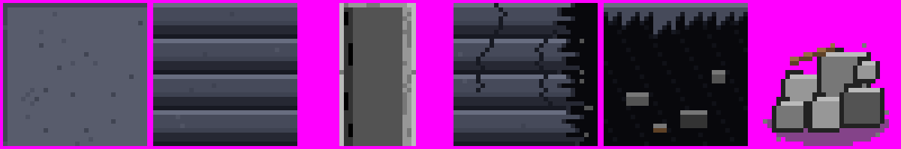
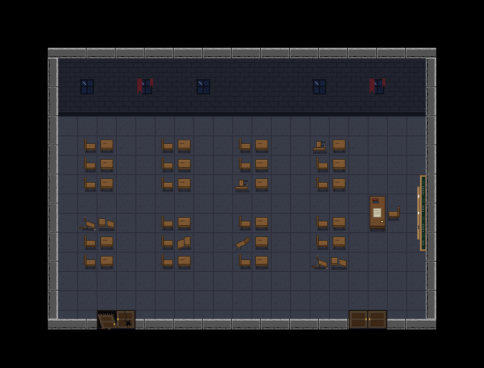
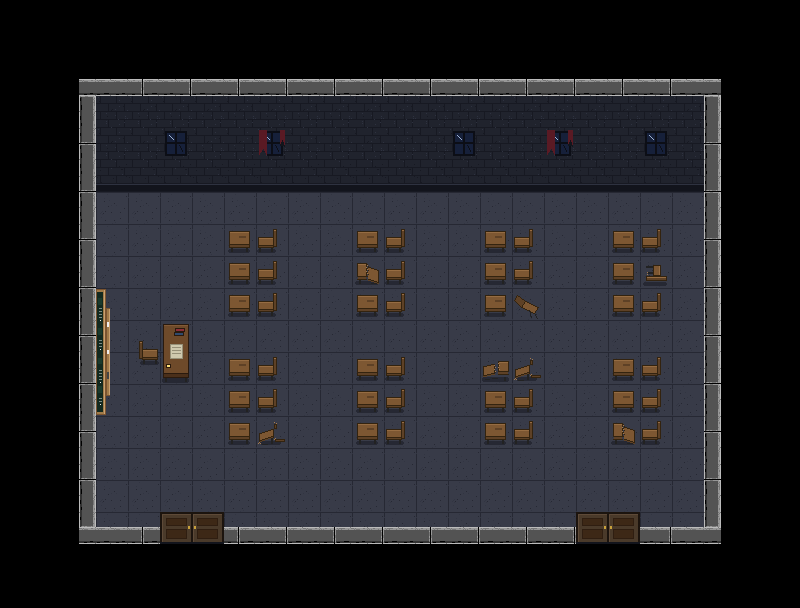
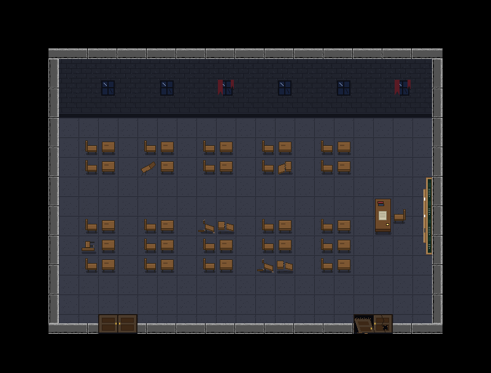
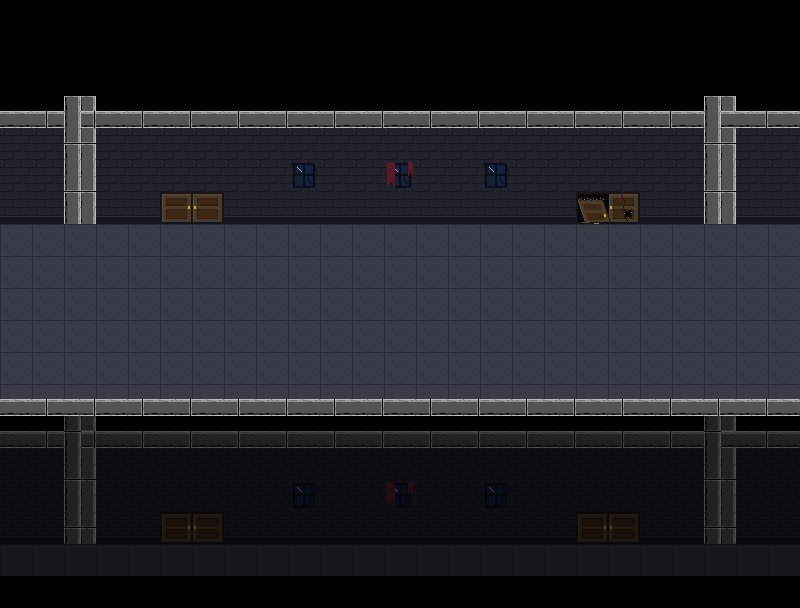
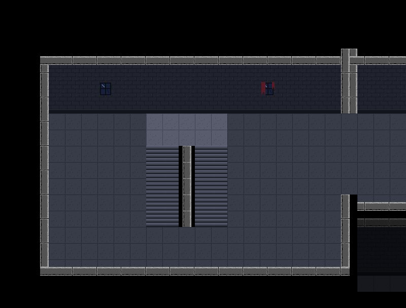
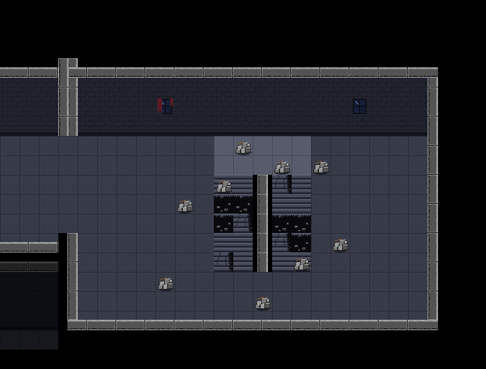
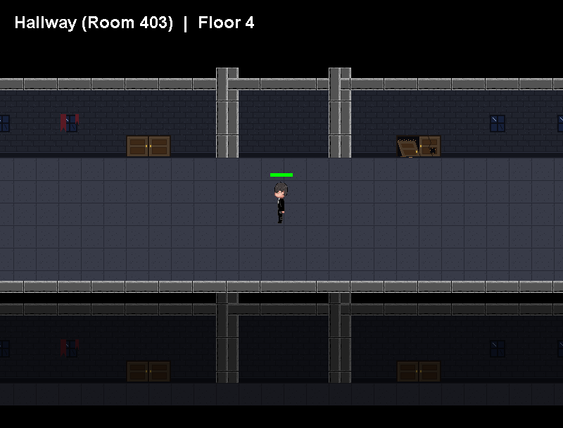

# Floor 4: Hallway, Stairs and the Linked List — a step-by-step guide

This guide explains everything that was added to build Floor 4. It goes in the same order the work was done, and each step says **what** was done, **why**, and **where to find it** in the code.

What was built:

- Two new classrooms to the left of the starting room: **Room 403**, which faces left, and **Room 402**, which has a different layout.
- A **hallway** (3 screens) running past the classrooms, based on your mockups but built from the `Classroom2` tiles.
- **Stairwells** at both ends of the hallway. The east one, next to Room 404, is destroyed. The west one works, but going down isn't implemented yet.
- **6 new stair tiles** in the same style.
- A **linked list** that connects every room, which replaces the old `mapX`/`mapY` grid.

---

## Contents

1. [The big picture](#1-the-big-picture)
2. [Step 1 — Planning the screens](#step-1--planning-the-screens)
3. [Step 2 — New stair tiles](#step-2--new-stair-tiles)
4. [Step 3 — `TileSet`: every tile in one place](#step-3--tileset-every-tile-in-one-place)
5. [Step 4 — `TileMap`: one screen, with collision worked out for you](#step-4--tilemap-one-screen-with-collision-worked-out-for-you)
6. [Step 5 — `MapBuilder`: placing tiles with code](#step-5--mapbuilder-placing-tiles-with-code)
7. [Step 6 — The three classrooms](#step-6--the-three-classrooms)
8. [Step 7 — The hallway screens](#step-7--the-hallway-screens)
9. [Step 8 — The stairwells](#step-8--the-stairwells)
10. [Step 9 — The linked list](#step-9--the-linked-list)
11. [Step 10 — Moving between rooms (Player and GamePanel)](#step-10--moving-between-rooms-player-and-gamepanel)
12. [Step 11 — Testing](#step-11--testing)
13. [Step 12 — A camera that follows the player in the hallway](#step-12--a-camera-that-follows-the-player-in-the-hallway)
14. [Step 13 — Drawing faster: caching each map](#step-13--drawing-faster-caching-each-map)
15. [What changed, file by file](#what-changed-file-by-file)
16. [Next steps](#next-steps)
17. [Glossary](#glossary)

---

## 1. The big picture

Floor 4 has 8 screens. The player moves between them in two ways: by walking off the **left or right edge** of the screen, or by walking through a **door**.

```
               [Room 402]       [Room 403]       [Room 404]  <- classrooms
                   |                |                |          (door links)
[West Stairs] <-> [Hallway 402] <-> [Hallway 403] <-> [Hallway 404] <-> [East Stairs]
   working                                                            destroyed
```

- The **5 bottom screens** form a chain from left to right. Each one knows its left and right neighbour.
- Each **classroom** hangs off the hallway screen in front of it and is reached through its door.
- The game starts in **Room 404**.

This chain of screens, where each one points at its neighbours, is a **doubly linked list**. [Step 9](#step-9--the-linked-list) explains it in detail.

### How the code is organised

| Package | Class | Job |
|---|---|---|
| `tile` | `TileSet` | Loads every tile image once and knows which tiles are solid |
| `tile` | `TileMap` | One screen: draws it, and answers "can I walk here?" and "am I on a door?" |
| `tile` | `MapBuilder` | Helper for building a `TileMap` step by step |
| `tile` | `Classroom` | The 3 classroom layouts |
| `tile` | `Hallway` | Builds a hallway screen |
| `tile` | `Stairs` | Builds the 2 stairwell screens |
| `world` | `Room` | A **node** of the linked list: one screen plus its links |
| `world` | `Floor` | The linked list itself: `head`, `tail`, `append()` |
| `world` | `World` | Creates every room and links them together |
| `Nightmareon404` | `GamePanel` | Keeps a pointer to the room the player is in |
| `Nightmareon404` | `Player` | Follows the links when walking through a door or off an edge |
| `Nightmareon404` | `MapPreviewDebug` | Debug tool: prints the list and saves a picture of every room |

**Rule of thumb:** the `tile` package knows what rooms **look like**, and the `world` package knows how rooms **connect**.

---

## Step 1 — Planning the screens

Before writing code, I read your three mockups and worked out a plan.

### Reading the mockups

In "Hallway outside starting room", the top wall has two doors: a crossed-out one on the left and a normal one on the right. Those are Room 404's two doors (the broken one at columns 5–6 and the double door at 18–19). So **the hallway sits directly below the classrooms**, and a classroom's bottom-wall door opens onto the hallway's top wall.

The red line with the brick wall under it is a **railing**. Below it you can see the floor underneath (the floor below's wall, doors and corridor), so the hallway is like a balcony.

### Keeping every screen on the same grid

Every screen is **25 columns × 18 rows** of 32 px tiles, the same as the classroom. To make walking between screens feel continuous, every hallway-type screen uses **the same rows**:

| Rows | What's there | Can you walk there? |
|---|---|---|
| 0–2 | void (black) | no |
| 3 | top edge of the classrooms' front wall | no |
| 4–5 | the front wall (windows on row 5) | no |
| 6 | bottom of the wall, with the classroom doors | only through a working door |
| **7–11** | **the corridor** | **yes** |
| 12 | the railing | no |
| 13–17 | the floor below, seen over the railing (darkened) | no |

The corridor is always rows 7–11, so when you walk off the right edge of one screen at row 9, you arrive on row 9 of the next screen, on floor.

### Keeping doors in the same columns

All classrooms have their doors at **columns 5–6 and 18–19**, and the hallway screens put their doors in the **same columns**. When you walk through a door, you come out at the door with the same column on the other side, so the player never jumps sideways.

---

## Step 2 — New stair tiles



The stairs needed pictures that don't exist in `Classroom2`, so I drew 6 new 32×32 tiles in **`res/tiles/Stairs/`**:

| File | What it is | Solid? |
|---|---|---|
| `stair_landing.png` | The platform at the top of the stairs: your floor tile, lightened | no |
| `stair_step.png` | 4 steps per tile: highlight, tread, shadow, riser | no |
| `stair_rail.png` | The stone divider between the two flights: your wall strip, centred | yes |
| `stair_step_broken.png` | A cracked step with a chunk missing | yes |
| `stair_hole.png` | A collapsed step: black drop with debris at the bottom | yes |
| `rubble.png` | A pile of stone with a splintered plank (transparent background) | yes |

**How they were made:** a small script drew them pixel by pixel using **colours copied from your tiles**: the blue-grey floor, the stone greys of the wall strips, and the brown of the desks. That's why they match the theme. They're ordinary PNGs, so you can open them in Aseprite and redraw them. As long as you keep the file names and the 32×32 size, the game picks up your versions automatically.

---

## Step 3 — `TileSet`: every tile in one place

**File:** [`src/tile/TileSet.java`](../src/tile/TileSet.java)

Before, the classroom loaded its own 36 images. With 8 screens, loading the same images 8 times would waste memory and time. So all images are loaded **once**, in `TileSet`, and every screen shares them.

### Tile IDs

Each tile has a number (its **ID**), which is its index in the `images` array:

| IDs | What | Where they come from |
|---|---|---|
| 0–35 | the classroom tiles | `res/tiles/Classroom2` (the same numbers as the file names) |
| 36–50 | mirrored furniture (`CHAIR_L`, `DESK_L`, ...) | **made in code** by flipping tiles 15–33 |
| 51–56 | stair tiles | `res/tiles/Stairs` |

The IDs have names (constants) so the code is readable: `TileSet.CHAIR` instead of `15`.

### Mirrored tiles: how Room 403 faces left

Your chair and desk pictures only face right. Room 403 needs chairs that face left, so `TileSet` makes flipped copies:

```java
// Returns a left-right flipped copy: pixel x is copied to (width - 1 - x)
private static BufferedImage mirror(BufferedImage src) {
    ...
    for (int y = 0; y < h; y++) {
        for (int x = 0; x < w; x++) {
            out.setRGB(w - 1 - x, y, src.getRGB(x, y));
        }
    }
    return out;
}
```

On a 32 px tile, pixel 0 goes to 31, pixel 1 goes to 30, and so on. That's all "mirroring" means. The flipped copies get their own IDs (36–50), so a map can use either version.

### Solid or walkable?

Instead of writing a SOLID grid by hand for every room, each **tile** says whether it blocks. The list of walkable tiles is short:

```java
private static final int[] WALKABLE = {
    FLOOR, DOOR_LEFT, DOOR_RIGHT, WINDOW, WINDOW_CURTAIN, STAIR_LANDING, STAIR_STEP
};
```

Everything else blocks the player: walls, furniture, void, rubble, holes and broken doors. (Windows are "walkable" only because they always sit on a wall, and the wall underneath is solid.)

---

## Step 4 — `TileMap`: one screen, with collision worked out for you

**File:** [`src/tile/TileMap.java`](../src/tile/TileMap.java)

A `TileMap` is one screen. It holds the same **4 layers** as your `ClassroomMap`, drawn in this order:

```
LAYER_FLOOR   -> floor, back wall, void
LAYER_WALLS_V -> vertical wall strips
LAYER_WALLS_H -> horizontal wall strips and corners
LAYER_OBJECTS -> furniture, doors, windows, rubble
(then the player is drawn on top)
```

### Collision is computed, not hand-written

When a `TileMap` is created, it looks at every cell and decides:

> A cell is **solid** if **any** tile on it, in any layer, is solid.

That replaces the hand-written `SOLID` grids. To check this, I compared the computed collision for Room 404 with your original `SOLID` grid: **0 cells differ** (see [Testing](#step-11--testing)). The advantage is that when you move a desk in an `OBJECTS` grid, collision updates automatically, and you can't forget to update a second grid.

### Doors are found automatically

A door is any `DOOR_LEFT` tile with a `DOOR_RIGHT` tile to its right, **if the player can stand on both**. Door pictures painted on a solid wall, like the ones on the floor below the railing, are decoration and not exits.

### Edges of the screen

```java
if (row < 0 || row >= ROWS) return true;   // above/below the map: solid
if (col < 0 || col >= COLS) continue;      // left/right of the map: open
```

Walking off the **top or bottom** is impossible, but walking off the **left or right** is allowed. That's how the player moves to the next screen. Where the building ends, the tiles themselves are walls, so the player can't reach the edge.

### Shading

`draw()` also fills the shaded areas with translucent black (`new Color(0, 0, 0, 150)`). That's what makes the floor below the railing look further away.

---

## Step 5 — `MapBuilder`: placing tiles with code

**File:** [`src/tile/MapBuilder.java`](../src/tile/MapBuilder.java)

Writing 4 grids of 25×18 numbers for every screen is a lot of typing and easy to get wrong. The classrooms still use grids, because those are easy to read and edit visually. The hallway and stairs screens are very repetitive, so they're built with commands:

| Method | What it does |
|---|---|
| `fill(layer, col0, row0, col1, row1, id)` | fills a rectangle with one tile (both ends included) |
| `set(layer, col, row, id)` | places one tile |
| `copy(layer, grid)` | copies a whole hand-written 25×18 grid (used by the classrooms) |
| `wallH(row, col0, col1)` | a horizontal wall strip, cycling through the 3 `wall_h` tiles |
| `wallVLeft(...)` / `wallVRight(...)` | a vertical wall strip on the left or right half of the tiles |
| `pillar(col, row0, row1)` | two wall strips back to back: where two rooms' walls meet |
| `shade(col0, row0, col1, row1)` | darkens an area |
| `edgeWall(col, row0, row1)` | an invisible wall along the left edge of a column, between two cells (see [Step 8](#entering-the-stairs-from-one-end-only)) |
| `build(tiles, ts)` | turns everything into a finished `TileMap` |

### Method chaining

Every method ends with `return this;`, which returns the builder itself. That lets you write calls one after another:

```java
return new MapBuilder()
        .copy(LAYER_FLOOR, SHELL_FLOOR)
        .copy(LAYER_WALLS_V, SHELL_WALLS_V)
        .copy(LAYER_WALLS_H, SHELL_WALLS_H)
        .copy(LAYER_OBJECTS, objects)
        .build(tiles, ts);
```

### The wall pattern

Your wall strips come in 3 variants (`wall_h_1/2/3`) that repeat. `wallH` picks the variant **by column**: `cycle[col % 3]`. `%` is the remainder after dividing: column 3 → 0, 4 → 1, 5 → 2, 6 → 0, and so on. That's the same pattern your classroom grids use, so walls line up exactly across neighbouring screens.

### A naming trap with vertical walls

The file names describe **where the stone strip sits inside the tile**, not which wall it's used for:

- `wall_v_left` has the strip on the tile's **left** half. It's used for a room's **right** wall (column 22).
- `wall_v_right` has the strip on the **right** half. It's used for a room's **left** wall (column 2).

---

## Step 6 — The three classrooms

**File:** [`src/tile/Classroom.java`](../src/tile/Classroom.java)

### One shell, different furniture

All classrooms share the same **shell**: floor, back wall, side walls, and a bottom wall with gaps at columns 5–6 and 18–19. Only the `OBJECTS` grid changes from room to room (furniture, windows, and which doors work). So `Classroom.java` contains:

- `SHELL_FLOOR`, `SHELL_WALLS_V` and `SHELL_WALLS_H`: your original grids, shared by every room
- `ROOM_404`, `ROOM_403` and `ROOM_402`: one `OBJECTS` grid per room
- `build(tiles, ts, objects)`: puts a shell and a furniture grid together into a `TileMap`

In the bottom wall row (row 16), the door tiles decide what happens:
- `21, 22` = a working door (walkable, leads to the hallway)
- `34, 35` = a broken door (solid)

### Room 404 — the starting room (unchanged)



This is your layout exactly. I compared it pixel by pixel with the old version: **0 differences**.

### Room 403 — facing left



To "mix up the orientation", Room 403 is a **mirror image** of 404's arrangement:
- The teacher's desk (`TEACHER_DESK_TOP_L`), the teacher's chair and the board are on the **left** wall (columns 3–5).
- Each student pair is **desk, then chair** (`DESK_L`, `CHAIR_L`), so students face left.
- The broken furniture is in different places, using mirrored broken tiles (`CHAIR_BROKEN_1_L` and others).
- **Both doors work.**

Its collision map (`#` = solid, `D` = door):

```
     0123456789012345678901234
  6  ###...................###
  7  ###....##..##..##..##.###
  8  ###....##..##..##..##.###
  9  ####...##..##..##..##.###   <- col 3: the board
 10  ######................###   <- cols 3-5: board, teacher's chair, teacher's desk
 11  ######.##..##..##..##.###
 12  ####...##..##..##..##.###
 13  ###....##..##..##..##.###
 14  ###...................###
 15  ###...................###
 16  #####DD###########DD#####   <- both doors work
```

### Room 402 — a different arrangement



Room 402 faces right like 404, but with **5 desk columns** (instead of 4), a **wide aisle** across rows 9–10, and different damage. **Only the left door works**; the right one is broken.

```
     0123456789012345678901234
  6  ###...................###
  7  ###.##.##.##.##.##....###
  8  ###.##.##.##.##.##....###
  9  ###..................####
 10  ###................######
 11  ###.##.##.##.##.##.######
 12  ###.##.##.##.##.##...####
 13  ###.##.##.##.##.##....###
 14  ###...................###
 15  ###...................###
 16  #####DD##################   <- only the left door
```

### How to add another classroom

1. Copy one of the `ROOM_...` grids in `Classroom.java` and give it a new name, for example `ROOM_401`.
2. Change the furniture numbers (see the tile ID list in `TileSet.java`).
3. Keep rows 14–15 in front of each door clear, so the player has somewhere to arrive.
4. Add a hallway screen and the classroom in `World.java` ([Step 9](#step-9--the-linked-list) shows how).

---

## Step 7 — The hallway screens

**File:** [`src/tile/Hallway.java`](../src/tile/Hallway.java)



This is a **temporary mockup**, like your pictures but built from your tiles:

| Your mockup | Built with |
|---|---|
| brown wall | `02_wall` + `03_wall_base` |
| grey cap along the top | `wall_h` strips (row 3) |
| vertical pillars between classrooms | `pillar()` at columns 2 and 22, where the classrooms' side walls are |
| doors (crossed out = broken) | `21/22` (working) or `34/35` (broken) |
| windows | `27_window`, `28_window_curtain` |
| wooden corridor floor | `01_floor` |
| red railing | `wall_h` strips (row 12) |
| the floor below | the same wall, doors and floor, darkened with `shade()` |

### The doors copy the classroom

`Hallway.outside(...)` is given the classroom's `OBJECTS` grid and **copies its bottom-wall door tiles**:

```java
for (int col : DOOR_COLS) {               // 5 and 18
    for (int half = 0; half < 2; half++) {
        int id = classroomObjects[Classroom.DOOR_ROW][col + half];
        b.set(LAYER_OBJECTS, col + half, BASE_ROW, id);
        if (id == DOOR_LEFT || id == DOOR_RIGHT) {
            b.set(LAYER_FLOOR, col + half, BASE_ROW, FLOOR);  // the wall base is solid; a working door isn't
        }
    }
    ...
}
```

So the hallway can never disagree with the classroom: if a door is broken inside, it's broken outside too. Hallway 402 shows Room 402's working left door and broken right door.

The second `set` matters: the wall base under the door is solid, so without it, a working door would sit on a solid cell and couldn't be used.

### Collision of a hallway screen

```
     0123456789012345678901234
  6  #####DD##################   <- the classroom door (402: only the left one works)
  7  .........................
  8  .........................   <- the corridor: open at both edges,
  9  .........................      so you can walk to the next screen
 10  .........................
 11  .........................
 12  #########################   <- railing
```

---

## Step 8 — The stairwells

**File:** [`src/tile/Stairs.java`](../src/tile/Stairs.java)

Both stairwells use the same layout, mirrored: the hallway comes in from one side and opens into a walled stairwell. The staircase is built by `staircase(b, left)`:

```
rows 7-8:   [ landing landing landing landing landing ]    (5 tiles wide)
rows 9-13:  [ step step ][ rail ][ step step ]             (two flights of steps, a rail in the gap)
```

### Entering the stairs from one end only

The stairs can only be stepped onto from **the bottom end of the flights**. The landing's top is the back wall, and the left and right sides are closed off:

```
        back wall (row 6)
      +--------------------+
      |  landing landing   |  rows 7-8
 wall |  step |rail| step  | wall      <- invisible walls on both outer sides
      |  step |rail| step  |
      |  step |rail| step  |  rows 9-13
         ^            ^
     enter here    or here (bottom end, row 13 -> 14)
```

**Why normal collision couldn't do this:** a cell is either solid or walkable. The stair cells must be walkable (you walk on them) but not enterable from the side, so the *cells* can't be what blocks you.

**The fix: edge walls.** An edge wall is a thin invisible rectangle (4 px wide) on the line **between** two columns. It's stored in the `TileMap` next to the tiles, and `collides()` checks it like a solid cell:

```java
for (Rectangle wall : edgeWalls) {
    if (box.intersects(wall)) return true;
}
```

The staircase adds one on each outer side:

```java
b.edgeWall(left, LANDING_TOP, FLIGHT_BOTTOM);       // left side
b.edgeWall(left + 5, LANDING_TOP, FLIGHT_BOTTOM);   // right side
```

Walking up a flight gets you onto the landing, and from there you can go down the other flight. Both stairwells use the same `staircase()` code, so the destroyed east stairs are closed at the sides too.

### West Stairs — working



At the left end of the hallway. The steps are walkable (you can walk all the way down them), but **nothing happens yet**. Going to another floor is the next step ([Next steps](#next-steps)).

### East Stairs — destroyed



Next to Room 404. It's built with the same `staircase()` and then damaged:
- **Holes** across the full width of each flight, so there's no way down
- **Broken steps** around the holes
- **Rubble** on the landing, the steps and the floor (all solid)

```
     0123456789012345678901234
  7  ............#.........###   <- rubble on the landing
  8  ..............#.#.....###
  9  ...........#.##.......###
 10  .........#.###........###   <- left flight: holes
 11  ...........#####......###   <- right flight: holes
 12  ####.........###.#....###
 13  ####.......#.#.#......###
```

---

## Step 9 — The linked list

**Files:** [`src/world/Room.java`](../src/world/Room.java), [`src/world/Floor.java`](../src/world/Floor.java), [`src/world/World.java`](../src/world/World.java)

### What is a linked list?

An **array** stores items side by side in memory and finds them by index: `rooms[2]`.

A **linked list** stores each item in a separate object called a **node**. Each node holds a **reference** (a pointer) to the next node. You move through the list by following references, like following signs from room to room.

A **doubly linked list** has references in **both** directions, so you can go forward and backward:

```
 head                                                                    tail
  |                                                                       |
  v                                                                       v
[West Stairs] <--> [Hallway 402] <--> [Hallway 403] <--> [Hallway 404] <--> [East Stairs]
  left = null                                                        right = null
```

`null` means "nothing there". `head.left` and `tail.right` are `null`, and in the game that means **a wall**.

A game map is a natural fit, because the player only ever moves to a **neighbour**, and a node knows its neighbours directly.

### The node: `Room`

```java
public class Room {
    public final String name;
    public final Floor floor;
    public final TileMap map;   // what this screen looks like

    public Room left;    // walk off the left edge  -> this room
    public Room right;   // walk off the right edge -> this room
    public Room door;    // walk through a door     -> this room
}
```

`left` and `right` make the hallway a doubly linked list. `door` is an **extra** link that connects a classroom to its hallway screen. The classroom isn't part of the left/right chain; it hangs off to the side:

```
room404.door == hall404      (classroom -> hallway)
hall404.door == room404      (hallway -> classroom)
room404.left == null, room404.right == null   (a classroom is walled on both sides)
```

### The list: `Floor`

`Floor` keeps track of the two ends of the list:

```java
public Room head;   // leftmost screen
public Room tail;   // rightmost screen
public int size;    // how many screens
```

#### Adding to the end: `append()`

This is the most important method. Here it is with each step explained:

```java
public Room append(String name, TileMap map) {
    Room room = new Room(name, this, map);
    if (head == null) {        // the list is empty:
        head = room;           //   the new room is both the first...
        tail = room;           //   ...and the last
    } else {
        tail.right = room;     // 1. the old last room points right to the new one
        room.left = tail;      // 2. the new room points left to the old last one
        tail = room;           // 3. the new room is now the last
    }
    size++;
    return room;
}
```

Here's what happens when `Hallway 403` is appended to a list that already has two rooms:

```
Before:   head -> [West] <-> [Hall 402] <- tail          [Hall 403]   (new, not linked yet)

Step 1:   [Hall 402].right = [Hall 403]                  [Hall 402] --> [Hall 403]
Step 2:   [Hall 403].left  = [Hall 402]                  [Hall 402] <-> [Hall 403]
Step 3:   tail = [Hall 403]

After:    head -> [West] <-> [Hall 402] <-> [Hall 403] <- tail
```

Adding to the end takes the same 3 steps however long the list is, because `tail` points straight at the end. That's called **O(1)**, or constant time.

#### Attaching a classroom: `addClassroom()`

```java
public Room addClassroom(String name, TileMap map, Room hallway) {
    Room classroom = new Room(name, this, map);
    classroom.door = hallway;    // classroom -> hallway
    hallway.door = classroom;    // hallway -> classroom
    return classroom;
}
```

Both directions are linked, so you can go in and come back out.

### Building the world: `World`

`World` creates everything in order:

```java
floor4 = new Floor(4);

// 1. The hallway, left to right
Room westStairs = floor4.append("West Stairs", Stairs.west(tiles, ts));
Room hall402    = floor4.append("Hallway (Room 402)", Hallway.outside(...ROOM_402...));
Room hall403    = floor4.append("Hallway (Room 403)", Hallway.outside(...ROOM_403...));
Room hall404    = floor4.append("Hallway (Room 404)", Hallway.outside(...ROOM_404...));
floor4.append("East Stairs (destroyed)", Stairs.eastDestroyed(tiles, ts));

// 2. The classrooms, each attached to its hallway screen
floor4.addClassroom("Room 402", Classroom.build(...ROOM_402), hall402);
floor4.addClassroom("Room 403", Classroom.build(...ROOM_403), hall403);
Room room404 = floor4.addClassroom("Room 404", Classroom.build(...ROOM_404), hall404);

start = room404;
```

The **order of the `append` calls is the order of the screens** from left to right. To add a screen between two others, you'd need an "insert after" method. That's a good exercise: it takes 4 reference changes instead of 3.

### Walking the list (traversal)

To visit every node, start at `head` and follow `right` until you reach `null`:

```java
for (Room r = floor4.head; r != null; r = r.right) {
    System.out.println(r.name);
}
```

This loop is used in `World.print()` (it prints the floor plan) and `Floor.find()` (it finds a room by name). Running `MapPreviewDebug` prints:

```
Floor 4 (5 hallway screens):
  West Stairs
  Hallway (Room 402)
      door -> Room 402
  Hallway (Room 403)
      door -> Room 403
  Hallway (Room 404)
      door -> Room 404   <- you are here
  East Stairs (destroyed)
```

### Why not `java.util.LinkedList`?

Java has a built-in `LinkedList`, but it **hides its nodes**. You can't ask an item "who is your neighbour?"; you'd have to find the item's index and then look up index ± 1. With our own `Room` nodes, moving to a neighbour is one step: `currentRoom = currentRoom.right`. Building your own nodes is also how you learn how a linked list really works.

### Linking floors: the second list

`Floor` already has these fields:

```java
public Floor above;   // floor reached by going up the stairs
public Floor below;   // floor reached by going down
public Room stairs;   // the working stairs on this floor (set to West Stairs)
```

The floors themselves will form a second doubly linked list (`floor4.below == floor3`, `floor3.above == floor4`). A list of floors, where each floor is a list of rooms, is called a **multilevel linked list**. Only Floor 4 exists for now, so `above` and `below` are `null`.

---

## Step 10 — Moving between rooms (Player and GamePanel)

### `GamePanel`: a pointer instead of coordinates

**Before:** the game remembered the room as grid coordinates (`mapX`, `mapY`) and worked out the next room with arithmetic (`mapX + 1`).

**Now:** the game remembers **which node the player is in**:

```java
public World world;
public Room currentRoom;     // starts at world.start (Room 404)

public void enterRoom(Room room) {
    currentRoom = room;
}
```

Drawing uses the current node's map: `currentRoom.map.draw(g2d)`, and the top-left label shows `Room 404  |  Floor 4`.

### `Player`: following the links

Every frame, after moving:

```java
moveWithCollision(gp.currentRoom.map, dx, dy);
if (gp.currentRoom.door != null && gp.currentRoom.map.doorTouching(solidArea) != null) {
    goThroughDoor();      // follow the door link
} else {
    checkScreenEdges();   // follow the left/right link
}
```

#### Walking off an edge

```java
int centre = x + size / 2;
if (centre < 0 && room.left != null) {        // centre crossed the left edge
    gp.enterRoom(room.left);                  // follow the link
    x += gp.screenWidth;                      // same spot in the world, now measured from the left room
}
...
if (room.left == null && x < 0) x = 0;        // null link = wall
```

`y` doesn't change, which is why every screen keeps the corridor on rows 7–11 ([Step 1](#step-1--planning-the-screens)). [Step 12](#step-12--a-camera-that-follows-the-player-in-the-hallway) explains why `x` shifts by a whole screen width.

#### Walking through a door

```java
Room next = gp.currentRoom.door;
gp.enterRoom(next);

Rectangle door = next.map.nearestDoor(solidArea.x + solidArea.width / 2);
x = door.x + door.width / 2 - size / 2;            // centred on the door
if (next.map.isFloorAbove(door)) {
    y = door.y - size - 2;                         // into a classroom: stand just above its door
} else {
    y = door.y + door.height - solidOffsetY + 2;   // into the hallway: stand just below its door
}
```

- `nearestDoor` picks the door in the new room closest to where you were. Doors share columns, so it's the matching door.
- `isFloorAbove` checks which side of the door is floor. A classroom's doors are in its **bottom** wall (floor above), and a hallway's doors are in its **top** wall (floor below).
- The **2 px gap** makes sure the player isn't still touching the door on arrival. Otherwise they'd be sent straight back.

---

## Step 11 — Testing

Everything was checked with simulated key presses (no window needed):

| Check | Result |
|---|---|
| Room 404 looks exactly as before | 0 pixels differ |
| Computed collision for Room 404 = your hand-written SOLID grid | 0 cells differ |
| Room 404's door → Hallway 404, arriving in the corridor | ✅ |
| Walking back up → Room 404, above the door | ✅ |
| Broken doors can't be entered (404 left, 402 right) | ✅ |
| Hallway 404 → right → East Stairs, and back | ✅ |
| The collapsed stairs can't be climbed | ✅ |
| Hallway 404 → 403 → 402 → West Stairs (walking left) | ✅ |
| Both of 403's doors work; 402's left door works | ✅ |
| The West Stairs steps can be walked on | ✅ |
| The building's end walls stop the player (both ends) | ✅ |
| Every `left` link points back to the previous node, `tail` is the last node, `size` is 5 | ✅ |
| Every door link goes both ways | ✅ |
| The down-walk animation test from before still passes | ✅ |

### Debug tools you can run

- **`MapPreviewDebug`**: prints the linked list and saves a picture of every room. Run it after changing a map:
  `java -Djava.awt.headless=true -cp "bin;res" Nightmareon404.MapPreviewDebug map_previews`
  In Eclipse: right-click the file → *Run As → Java Application*. The pictures go to `map_previews/` in the project.
- **`WalkStripDebug`**: the walk-animation check from before.

---

## Step 12 — A camera that follows the player in the hallway

**Files:** [`GamePanel.java`](../src/Nightmareon404/GamePanel.java) (`cameraX()`, `paintComponent()`), [`Player.java`](../src/Nightmareon404/Player.java) (`checkScreenEdges()`, `blocked()`)



### The problem

At first the game used **fixed screens**: the view never moved, and walking off an edge cut to the next screen. That suits the classrooms, which are each designed as one screen. But the hallway is one long corridor, and cutting between screens in the middle of it felt choppy.

### The idea

A **camera** is a number saying how far the view is scrolled. Drawing the world "through the camera" means shifting everything left by that amount before drawing:

```java
view.translate(-camX, 0);    // move the drawing origin
currentRoom.map.draw(view);  // the room is drawn camX pixels further left
```

If `camX` is 200, the room is drawn 200 px to the left, so you see its right part. The empty space on the right then has to show **the next room**, and the linked list already knows which one that is: `currentRoom.right`. It's drawn one screen width further along:

```java
if (camX < 0) {
    drawNeighbour(view, currentRoom.left, -screenWidth);   // room on the left
} else if (camX > 0) {
    drawNeighbour(view, currentRoom.right, screenWidth);   // room on the right
}
```

So the hallway screens stay separate nodes, and the camera simply draws two of them side by side.

### Where the camera points

```java
public int cameraX() {
    int camX = flor.x + tileSize / 2 - screenWidth / 2;    // put the player in the middle
    if (currentRoom.left == null) camX = Math.max(camX, 0);  // nothing on the left: don't scroll left
    if (currentRoom.right == null) camX = Math.min(camX, 0); // nothing on the right: don't scroll right
    return camX;
}
```

- **Line 1** centres the player. If the player stands at x = 600, then camX = 600 + 16 − 400 = 216.
- **Lines 2–3** are a **clamp**: never scroll toward a `null` link, because there'd be nothing to draw there.

The clamp gives three behaviours from one rule:

| Where | Links | Camera |
|---|---|---|
| Classroom | `left` and `right` are both `null` | always 0: a fixed screen, as before |
| West Stairs | `left` is `null` | can't scroll left: the view stops at the end of the building |
| Middle of the hallway | both links set | follows the player freely |

### Crossing into the next node smoothly

The player's `x` is always measured from the **current room's** left edge. When the player crosses into the next room, the same spot in the world gets a different number:

```
          Hallway 403 (x 0-799)          Hallway 404 (x 0-799)
   |------------------------------|------------------------------|
                               ^ player at x = 790 in Hallway 403
                                 = x = -10 in Hallway 404
```

So instead of teleporting to the far edge, the player is moved to the next node and `x` is shifted by exactly one screen width (`x -= 800`). The camera is calculated from `x`, so it shifts by the same amount. Both changes cancel out, and **nothing on screen moves**. The tests confirmed this: across all four crossings, the player and the camera never moved more than 3 px in a frame (the walking speed).

The switch happens when the player's **centre** crosses the edge, not their side. This means the player is never more than half a tile outside the current room.

### Collision at the seam

Near an edge, part of the hitbox can stick into the neighbouring room. `blocked()` checks that part against the neighbour's map, moved by one screen width:

```java
if (solidArea.x + solidArea.width > gp.screenWidth && room.right != null) {
    return room.right.map.collides(shifted(-gp.screenWidth));
}
```

### Doors still cut

Going through a door is still a straight cut, which is good: walking into a classroom is a change of scene. Because classrooms have no left/right links, the camera is 0 inside them, so a classroom always fills the screen exactly.

---

## Step 13 — Drawing faster: caching each map

**Files:** [`TileMap.java`](../src/tile/TileMap.java) (`draw()`, `render()`, `newScreenImage()`, `clearCache()`), [`GamePanel.java`](../src/Nightmareon404/GamePanel.java) (`ROOM_NAME_FONT`)

### The problem

A game redraws the whole screen about 60 times a second. Before this change, every one of those redraws went through all 4 layers × 450 cells of the map and drew each tile separately: around 600–700 `drawImage` calls per frame, and up to about 1,300 while the hallway scrolls (two maps on screen). But **the maps never change**: frame after frame, the same tiles were drawn in the same places.

### The idea: draw once, copy many times

A **cache** is a saved result you reuse instead of working it out again. Here, the saved result is a picture of the whole map:

```
Before:  every frame  ->  draw 600+ tiles one by one
After:   first frame  ->  draw 600+ tiles into an image (the cache), once
         every frame  ->  copy that one image to the screen
```

### The code, piece by piece

**1. A field to hold the picture.** It starts as `null`, meaning "not drawn yet":

```java
private BufferedImage cache;
```

**2. `draw()` builds the picture the first time, then reuses it:**

```java
public void draw(Graphics2D g2d) {
    if (cache == null) {
        cache = render();          // only happens once per map
    }
    g2d.drawImage(cache, 0, 0, null);
}
```

This is called **lazy** creation: the picture is only made when it's first needed. A room you never visit never costs memory.

**3. `render()` is the old drawing code, pointed at an image instead of the screen.** `image.createGraphics()` gives a "pen" that draws onto the image. The loops are the same as before. At the end, `g.dispose()` puts the pen away to free its resources:

```java
BufferedImage image = newScreenImage(COLS * ts, ROWS * ts);   // 800 x 576
Graphics2D g = image.createGraphics();
... draw every layer and the shading with g ...
g.dispose();
return image;
```

One small change: tiles are drawn with `drawImage(img, x, y, null)` instead of `drawImage(img, x, y, ts, ts, null)`. The tiles are already 32×32, so there's no need for the version that resizes.

**4. `newScreenImage()` makes the image in the screen's own format.** Images can store pixels in different formats, and the screen has its own. If an image is in a different format, Java converts every pixel each time it's drawn. A **compatible image** is already in the screen's format, so Java can copy it directly and even keep it on the graphics card:

```java
GraphicsConfiguration screen = GraphicsEnvironment.getLocalGraphicsEnvironment()
        .getDefaultScreenDevice().getDefaultConfiguration();
return screen.createCompatibleImage(width, height, Transparency.OPAQUE);
```

`OPAQUE` means "no transparent pixels". Every cell of a map has a tile (empty space is the black void tile), so the cached picture has nothing see-through, and opaque images are the fastest to draw.

The debug tools run without a window ("headless"), where there's no screen to ask, so they get a plain image instead:

```java
if (GraphicsEnvironment.isHeadless()) {
    return new BufferedImage(width, height, BufferedImage.TYPE_INT_RGB);
}
```

**5. `clearCache()` for maps that change.** Nothing changes a map during the game yet. If something does later, such as a door being smashed or rubble cleared, change the tiles and call `map.clearCache()`. The next `draw()` sees `null` and redraws the picture once with the new tiles.

**6. The font.** `GamePanel` used to run `new Font("Arial", Font.BOLD, 24)` inside `paintComponent()`, creating a new font object 60 times a second. It's now a constant (`ROOM_NAME_FONT`) made once.

### Results

| | Before | After |
|---|---|---|
| Frame in a classroom | 2.55 ms | **0.41 ms** |
| Frame in the scrolling hallway | 3.14 ms | **0.46 ms** |
| What the rooms look like | | identical (0 pixels differ in all 8 rooms) |

At 60 FPS there are 16.7 ms per frame, so drawing the map now uses under 3% of it. That leaves room for expensive effects later, like darkness and a flashlight.

**The cost:** memory. Each cached picture is 800 × 576 pixels × 4 bytes ≈ 1.8 MB, so about 15 MB if you visit all 8 rooms. That's a good trade.

### When caching is the wrong tool

Caching works because the map is **static** (it doesn't change). Things that move or change every frame, like the player and later enemies and flickering lights, are still drawn every frame on top of the cached map. Caching them would mean rebuilding the cache every frame, which saves nothing.

---

## What changed, file by file

| File | Change |
|---|---|
| `res/tiles/Stairs/*.png` | **new**: 6 stair tiles |
| `src/tile/TileSet.java` | **new**: loads all tiles once; mirrored furniture; solid/walkable |
| `src/tile/TileMap.java` | **new**: one screen; computed collision and doors |
| `src/tile/MapBuilder.java` | **new**: helper for building maps |
| `src/tile/Hallway.java` | **new**: hallway screens |
| `src/tile/Stairs.java` | **new**: the two stairwells |
| `src/world/Room.java` | **new**: linked-list node |
| `src/world/Floor.java` | **new**: the linked list |
| `src/world/World.java` | **new**: builds and links Floor 4 |
| `src/Nightmareon404/MapPreviewDebug.java` | **new**: debug tool |
| `src/tile/Classroom.java` | rewritten: shared shell + 3 furniture grids; the SOLID/DOORS arrays are replaced by computed collision |
| `src/Nightmareon404/GamePanel.java` | `mapX`/`mapY`/`tileM` replaced by `world` + `currentRoom`; camera (`cameraX()`) and neighbour drawing |
| `src/Nightmareon404/Player.java` | moves by following `left`/`right`/`door` links; smooth edge crossing; collision checks the neighbour at a seam |
| `src/tile/Tilemanager.java`, `src/tile/Tile.java` | **removed**: replaced by `TileSet`/`TileMap`. The old open "plain rooms" (walk off any edge forever) are gone; the world is now exactly the linked rooms |

The old images in `res/tiles/` (outside `Classroom2` and `Stairs`) are no longer used.

---

## Next steps

### Making the west stairs work

A sketch of what's needed:

1. Build Floor 3 in `World` the same way as Floor 4 (`new Floor(3)`, `append`, `addClassroom`).
2. Link the floors: `floor4.below = floor3; floor3.above = floor4;` and set each floor's `stairs`.
3. Give the stairs a trigger, for example "the player stands on the bottom step, row 13". A `TileMap` could find `STAIR_STEP` tiles the way it finds doors.
4. In `Player`, when the trigger fires: `gp.enterRoom(gp.currentRoom.floor.below.stairs)` and place the player on the landing.

### Ideas to practise linked lists

- Write `Floor.insertAfter(Room existing, String name, TileMap map)` to add a screen in the middle.
- Write `Floor.remove(Room r)`, for example for a hallway that gets blocked off.
- Draw a **minimap** by walking the list and drawing a small box for each room, highlighting `currentRoom`.

---

## Glossary

| Term | Meaning |
|---|---|
| **Tile** | A 32×32 picture; maps are grids of tiles |
| **Tile ID** | The number that identifies a tile (index into `TileSet`'s image array) |
| **Layer** | One grid of tile IDs; the 4 layers are drawn on top of each other |
| **Solid** | The player can't walk into it |
| **Hitbox** (`solidArea`) | The 16×16 box at the player's feet that's used for collision |
| **Node** | One item in a linked list; here, a `Room` |
| **Reference / pointer / link** | A variable that refers to another object, such as `room.right` |
| **`null`** | "No object"; here, a link to nothing, which means a wall |
| **Head / tail** | The first and last node of a list |
| **Doubly linked list** | A list where each node links to both the next and the previous node |
| **Traversal** | Visiting every node by following links from the head |
| **O(1)** | Takes the same time no matter how big the list is |
| **Method chaining** | Calling methods one after another, because each returns `this` |
| **Cache** | A saved result that's reused instead of being worked out again |
| **Lazy creation** | Making something only when it's first needed |
| **Compatible image** | An image stored in the screen's own pixel format, so it can be drawn without converting |
| **Static (content)** | Doesn't change while the game runs, like a room's tiles |
