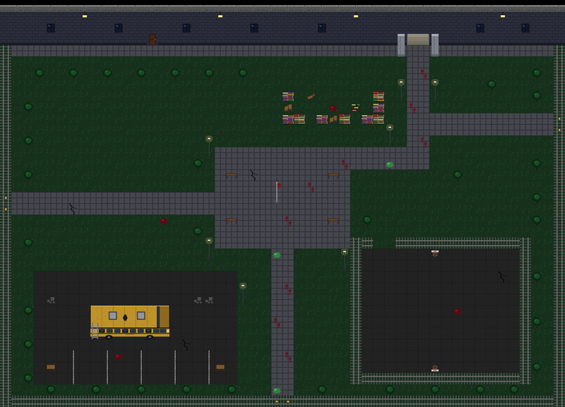
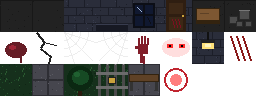
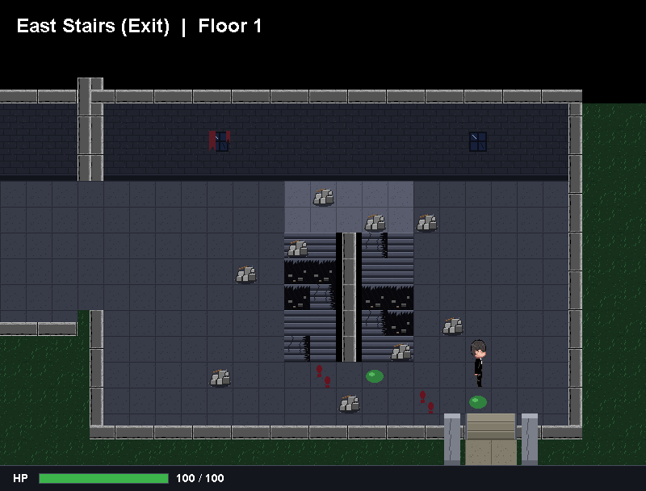
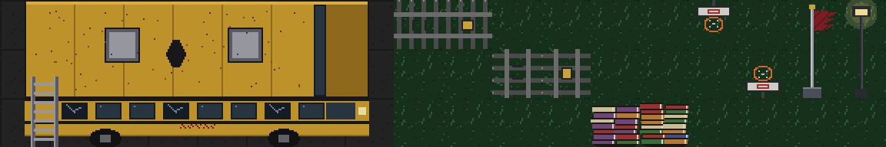
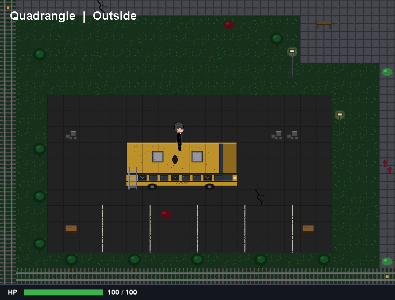
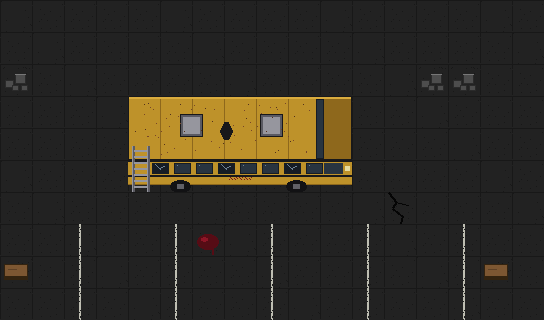
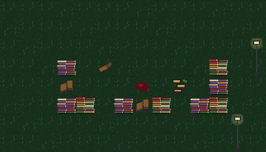
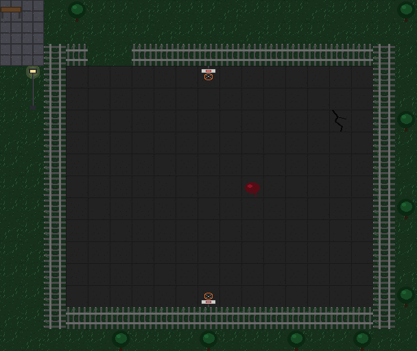

# The Quadrangle — a step-by-step guide

The school's courtyard, outside the ground floor's open exit. This is where the **last stand** will happen. Here's what was added:

- **One big map: 50 × 36 tiles**, the area of 2 × 2 rooms (1600 × 1152 pixels).
- **A camera centred on the player**, scrolling up and down as well as sideways, and stopping at the map's edges.
- **Three strongholds** where the player has better odds: **the Wrecked Bus**, **the Book Barricade** and **the Cage**.
- **Three locked gates** in the perimeter fence, where attackers will break in.
- **46 new tiles**: cut from your sheet, plus a school bus, fences, book barricades, hoops, a flagpole, lampposts and parking lines.
- **Ready for the fighting:** a list of the strongholds and gates for the gameplay to use, and a new tile property, "can a bullet pass through this?".



---

## Step 1 — Reading the sheet



It follows the same template as the floors' sheets: dark **asphalt**, the building's outside **wall** with a window, lamp and door, and the usual horror decals (byte-identical to the earlier ones, so reused). The bottom row has the outdoor pieces:

| Piece | Used as |
|---|---|
| Grass | all the grass, here **and on the ground floor** (see below) |
| Stone paving | the paths and the central plaza |
| Tree | trees (cover) |
| Fence with a padlock | the perimeter fence, its locked gates, and the cage round the court |
| Park bench | benches around the plaza |
| Red ring | the same tile as the ground floor's fire alarm, so not loaded twice |

### The ground floor's grass changed too

Floor 1 used grass I had drawn, because no grass existed yet. Now that your sheet has grass, **the ground floor uses it too**, so leaving the building lands you on the same ground. Only the grass on Floor 1's screens changed.



---

## Step 2 — The tiles

**Folder:** `src/main/resources/tiles/quad/` (46 files)



### Fences, from one tile

Your fence tile has a padlock. Its bars **repeat every 8 pixels** (at x = 2, 10, 18, 26), so the padlock can be painted over by copying the pixels from 8 to its left, which are the same bars and grass without a lock:

```python
for y in range(13, 20):
    for x in range(13, 21):
        p[x, y] = p[x - 8, y]
```

That gives a plain fence section. **Turning it 90°** gives the fence for the left and right edges. The original, with its padlock, is the **locked gate**.

### Drawn new

| Art | Size | Notes |
|---|---|---|
| Wrecked school bus | 7 × 3 tiles | roof (2 rows: seams, two hatches, rust, a hole punched through); side (smashed windows, wheels, blood); **a ladder at the back** |
| Book barricades | 2 tiles | tall piles of library books, see-through background |
| Basketball hoops | 2 tiles | backboard and ring; one for each end of the court (the second is the first flipped) |
| Flagpole | 1 × 2 | torn dark-red flag |
| Lamppost | 1 × 2 | with a faint glow (semi-transparent pixels) |
| Parking line | 1 | worn white paint |

The **tops** of the flagpole and the lampposts are walkable: they're up in the air, so you walk past underneath them. Only their bases are solid.

---

## Step 3 — Maps bigger than one screen

**Files:** [`MapBuilder.java`](../src/main/java/nightmare404/tile/MapBuilder.java), [`TileMap.java`](../src/main/java/nightmare404/tile/TileMap.java), [`Ground.java`](../src/main/java/nightmare404/map/Ground.java)

Until now **every map was exactly one screen**, and the code said so everywhere: `ROWS` (18) and `COLS` (25) were used for every loop. Now each map has **its own size**:

```java
public MapBuilder()                       // one screen: 25 x 18, as before
public MapBuilder(int cols, int rows)     // any size: the quadrangle is new MapBuilder(50, 36)
```

and a `TileMap` knows its size from its layers:

```java
this.rows = layers[0].length;
this.cols = layers[0][0].length;
```

Every loop that used `ROWS` / `COLS` now uses the map's own `rows` / `cols`. `TileMap` also gives its size in pixels, `widthPx()` and `heightPx()`, for the camera. `ROWS` and `COLS` still exist; they mean "one screen".

**Proof nothing broke:** every existing screen was re-rendered and compared. All of them are pixel-identical, except for the grass change on Floor 1.

---

## Step 4 — A camera that follows in both directions

**File:** [`GamePanel.java`](../src/main/java/nightmare404/main/GamePanel.java)

The camera already followed the player **sideways** in the hallway. It now does the same **up and down**:

```java
public int cameraX() {
    if (currentRoom.fixedScreen) return 0;
    int camX = flor.x + tileSize / 2 - screenWidth / 2;                 // player in the middle
    if (currentRoom.left == null) camX = Math.max(camX, 0);                // never past the left edge
    if (currentRoom.right == null) camX = Math.min(camX, currentRoom.map.widthPx() - screenWidth);
    return camX;
}

public int cameraY() {
    if (currentRoom.fixedScreen) return 0;
    int viewHeight = screenHeight - tileSize;                             // the UI bar covers the bottom row
    int camY = flor.y + tileSize / 2 - viewHeight / 2;
    return Math.max(0, Math.min(camY, currentRoom.map.heightPx() - viewHeight));
}
```

Both work the same way: **centre on the player, then clamp**, so the view never goes past the map's edge.

| Where | What the clamp does |
|---|---|
| A classroom (one screen, no neighbours) | `max(…, 0)` and `min(…, 0)`: the camera is always 0, as before |
| The hallway | it can scroll past an edge into the neighbouring screen, as before |
| The quadrangle | x stays between 0 and 800, y between 0 and 576: it follows the player until the map's edge, then stops |

The view is **576 px tall**, not 608, because the UI bar covers the bottom 32 px. A one-screen map is exactly 576 px tall, so it never scrolls vertically. Only the quadrangle does.

Drawing then shifts the world by both amounts:

```java
view.translate(-camX, -camY);
```

The player's edge handling (`Player.checkScreenEdges`) also uses the map's own width now, so on the quadrangle you're stopped at the map's edge, not the screen's.



---

## Step 5 — Building it: two character maps

**File:** [`Quadrangle.java`](../src/main/java/nightmare404/map/Quadrangle.java)

Indoors, what's under each character (floor or wall) depended only on its **row**. Outdoors the ground varies everywhere (grass, paths, asphalt), so the quadrangle uses **two character maps of the same size**:

- **`GROUND`**: what's underfoot. `.` grass, `,` paving, `:` asphalt, `w` the building's wall, `_` its base.
- **`THINGS`**: what stands on it. Trees, benches, fences, book piles and so on, with `.` meaning nothing.

Both are 36 strings of 50 characters. The `Underlay` used by `paint` simply looks the cell up in `GROUND`:

```java
private static int ground(int col, int row) {
    char ch = GROUND[row].charAt(col);
    return switch (ch) {
        case '.' -> Ground.grass(col, row);
        case ',' -> PAVING;
        case ':' -> ...asphalt...;
        ...
    };
}
```

That's the payoff of making the underlay an interface on Floor 2: the indoor rooms pick by row, the quadrangle picks from a second map, and `paint` works the same for both.

A few things are **placed in code** instead, because they're bigger than a tile or need invisible walls: the doorway back into the building (with its pillars), the bus, and the court's fence.

### The layout

```
 ┌───────────── the building's south face (windows, lamps, the doorway) ─────────────┐
 │  trees ... walkway along the building ...           [BOOK BARRICADE]  doorway ↓     │
 │                                                                         main path    │
 West gate ◄═══ path ═══ [  PLAZA: flagpole, benches, lampposts  ] ═══ path ═══► East gate
 │                                │                                                    │
 │  [ CAR PARK with THE BUS ]     │ path                    [ THE CAGE: fenced court ]  │
 │  crates, picnic tables         │                                                    │
 └──────────────────────────── fence ═══ South gate ═══ fence ─────────────────────────┘
```

---

## Step 6 — The three strongholds

The open grass between them is **dangerous ground**: there's little cover, and attackers from three gates can reach you there. The strongholds are where the odds turn.

### 1. The Wrecked Bus: high ground with one way up



The bus's **roof can be walked on**, but you can only get there **up the ladder at the back**:

```java
b.edgeWall(col, row, row + 2);                  // back of the roof, and the ladder's outer side
b.edgeWall(col + BUS_WIDTH, row, row + 1);      // front of the roof
b.edgeWallH(row, col, col + BUS_WIDTH - 1);     // far side of the roof
```

The near side of the roof is the bus's side, which is solid except for the ladder. So the roof is walled in on every side but one, and that one is a single-tile ladder. **Attackers have to climb it one at a time**, while from the roof you can see the whole car park. Crates and picnic tables around the bus give extra cover at ground level.

`edgeWallH` is new: the stairs' invisible walls only ran **down** the side of a column. The bus also needed one running **along** the top of a row.

### 2. The Book Barricade: a frontier with two gaps



Students dragged books out of the library and broken desks out of the classrooms to build a wall just south of the entrance. It's a **U shape**:

- **Its front faces south**, towards the plaza and the south gate where attackers come from. The front row has just **two one-tile gaps**, so attackers funnel into them.
- **Its back is open towards the building**, a short dash from the doorway, which is also a retreat.

During testing, a lamppost turned out to stand right in front of one gap, where it would have blocked shots through it. It was moved, which is the kind of thing that only matters once you think about the line of fire.

### 3. The Cage: walls that stop attackers but not bullets



The basketball court is fenced all round, with **one 2-tile gate**. The key is that a fence **stops movement but not shots**. Attackers have to walk all the way round to the gate while you shoot them through the fence. Inside, the hoops at each end are a little extra cover.

That "stops movement but not shots" needed a new idea in the code, which is Step 7.

---

## Step 7 — Ready for the fighting

Nothing fights yet. These are prepared so the gameplay has something to build on.

### `TileSet.isShootThrough(id)`

```java
// Solid tiles that a bullet could still pass through
private static final int[] SHOOT_THROUGH = { FENCE_H, FENCE_V, GATE_H, GATE_V, PARK_BENCH, Q_TABLE, BENCH };

public boolean isShootThrough(int id) {
    return !solid[id] || shootThrough[id];   // anything you can walk on, plus fences, benches...
}
```

Walls, trees, the bus's side and the book piles stop bullets. Fences, gates, benches and picnic tables don't, and neither does anything you can walk on.

### `Quadrangle.STRONGHOLDS` and `Quadrangle.SPAWN_GATES`

```java
public record KeyLocation(String name, Rectangle area, String whyItHelps) {}

public static final List<KeyLocation> STRONGHOLDS = List.of(
        new KeyLocation("The Wrecked Bus", ..., "High ground. The roof is walled in on three sides; ..."),
        new KeyLocation("The Book Barricade", ..., "..."),
        new KeyLocation("The Cage", ..., "..."));

public static final List<Point> SPAWN_GATES = List.of(
        new Point(0, 17), new Point(WIDTH - 1, 10), new Point(24, HEIGHT - 1));
```

Ideas for using them:
- **Spawning:** waves of attackers appear at `SPAWN_GATES` (west, east, south).
- **The HUD:** show "You're at: The Wrecked Bus" when the player is inside a stronghold's `area`.
- **Balance:** less damage taken inside a stronghold, or attackers that prefer the open ground.

### The creature's trail

The footprints and slime from the Containment Lab lead down the collapsed stairs, out of the ground floor's exit, across the quadrangle and **to the south gate**. That's a hint about where the first wave comes from.

---

## Step 8 — Testing

A quadrangle play-through, `QuadCheck` (39 checks; run it with `run-checks.bat`):

| Area | Checks |
|---|---|
| Size and links | 50 × 36 tiles; linked both ways with the ground floor's exit; marked outdoors |
| In and out | out of the exit → just below the quadrangle's doorway; back in → just above the exit |
| Camera | player exactly in the middle of the view mid-map; the camera stops at (0, 0) top-left and (800, 576) bottom-right; it moves when you walk |
| The bus | up the ladder onto the roof; along the roof; can't step off the front, side or far side; can't get on from below, above, behind, in front, or onto the ladder from the side |
| The barricade | the front row blocks from both sides; both gaps let you through; the back is open |
| The cage | the fence blocks from outside and inside; the gate lets you through; the fence blocks walking but not shots |
| Perimeter | the west, east and south fences stop you; all three spawn gates are locked gates in the fence |
| Data | 3 strongholds; most of each stronghold's area can be stood on |

Plus:
- **all earlier screens are pixel-identical**, except the grass on Floor 1;
- **all earlier tests pass**. Two Floor 1 checks were updated: they were written when the exit led nowhere, and now it leads to the quadrangle.

---

## What changed, file by file

| File | Change |
|---|---|
| `src/main/resources/tiles/quad/` | **new**: 46 tiles |
| `src/main/resources/tiles/ground/grass_*.png` | remade from your sheet's grass |
| `docs/images/quad_sheet.png` | your original sheet |
| `src/main/java/nightmare404/map/Quadrangle.java` | **new**: the map (two character maps), the bus, the cage, the doorway, `STRONGHOLDS`, `SPAWN_GATES` |
| `src/main/java/nightmare404/tile/MapBuilder.java` | maps of any size; `edgeWallH` |
| `src/main/java/nightmare404/tile/TileMap.java` | each map has its own `cols`/`rows`; `widthPx()`/`heightPx()` |
| `src/main/java/nightmare404/tile/TileSet.java` | IDs 182–227; `isShootThrough` |
| `src/main/java/nightmare404/map/Ground.java` | uses the map's own size |
| `src/main/java/nightmare404/world/Room.java` | `outdoors` flag |
| `src/main/java/nightmare404/world/World.java` | attaches the quadrangle to the ground floor's exit |
| `src/main/java/nightmare404/main/GamePanel.java` | `cameraY()`; both camera directions clamp to the map; the label says "Outside" outdoors |
| `src/main/java/nightmare404/entity/Player.java` | screen edges use the map's width |
| `src/test/java/nightmare404/debug/MapPreviewDebug.java` | saves big maps at full size |

---

## Editing the quadrangle

- **Move things around:** edit `GROUND` and `THINGS` in `Quadrangle.java`. Every line must be exactly 50 characters (the game tells you if not).
- **Move a stronghold:** the bus's position is `BUS_COL`/`BUS_ROW`, and the cage's is `CAGE_LEFT`/`CAGE_TOP`/... Keep the ground under the bus as asphalt (`:`), and the ground under the cage's fence as grass (the fence tiles have grass drawn in).
- **Things with a drawn-in background** belong on their own ground: crates and picnic tables on asphalt, benches on paving, trees and fences on grass.
