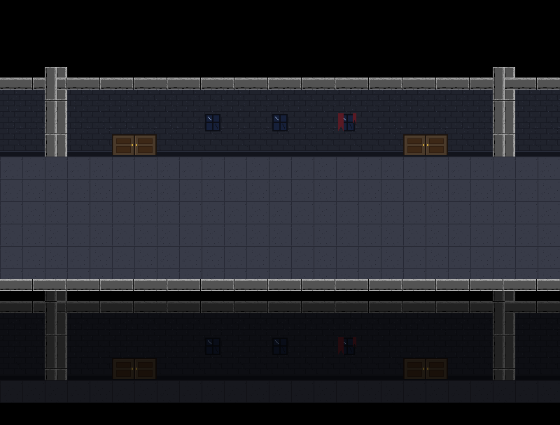
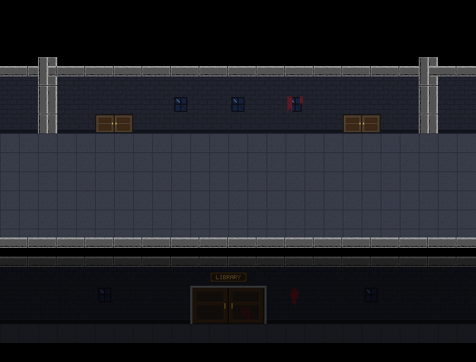
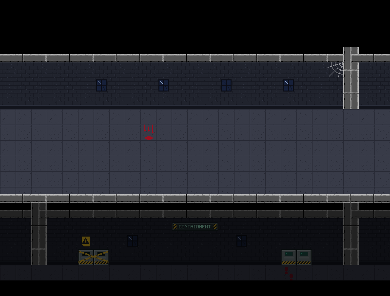
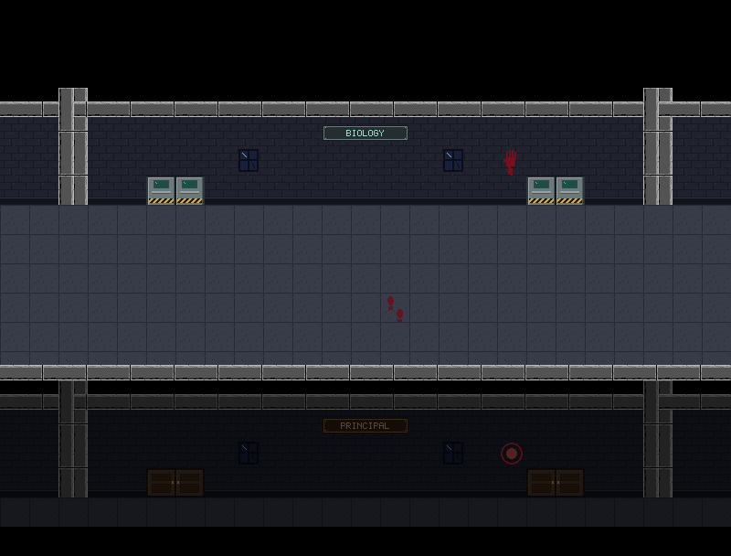

# The view over the railing — a step-by-step guide

Every hallway screen on Floors 4, 3 and 2 has a darkened strip below its railing: the floor below, seen from above, a teaser of what's coming. Until now that strip was a **generic picture**: the same wall, classroom doors and pillars on every floor. Now it shows **exactly what's really below**.

| Before | After |
|---|---|
|  |  |
| Floor 4 above the library entrance: generic classroom doors | the real Floor 3: the LIBRARY plaque, the big double door, the bloody handprint, and no pillars in the middle (it's one long room) |

More examples:

- **Floor 3, above the Containment Lab:** the sealed door with its hazard sign, the steel door, the CONTAINMENT plaque, and the first footprints of the creature's trail.
  
- **Floor 2, above the Principal's Office:** the PRINCIPAL plaque, the fire-alarm bell and the wooden doors.
  

---

## Step 1 — Noticing the pattern

Two facts make this possible:

1. **Every floor's hallway has the same 5 screens in the same order** (west stairs, three hallway screens, east stairs). So screen 1 of Floor 4 is directly above screen 1 of Floor 3, screen 2 above screen 2, and so on.
2. **The strip lines up with the floor below's wall.** The strip is rows 13–17 of a screen. On every hallway screen, rows 3–7 are the top of the wall, the wall, the base with the doors, and the first row of the corridor. Those are exactly the things the strip shows. So **row 13 shows row 3 of the screen below, row 14 shows row 4, and so on**: always 10 rows lower.

So the accurate picture doesn't need to be drawn. It can be **copied** from the screen below.

---

## Step 2 — A "view": part of one map that shows another

**File:** [`TileMap.java`](../src/main/java/nightmare404/tile/TileMap.java)

A **view** is a rectangle of a map that shows part of another map:

```java
public record View(int col0, int row0, int col1, int row1, int sourceRow0) { ... }
```

A **record** is a short way to write a small class that only holds a few values. Java writes the constructor and the getters for you: `view.row0()`, `view.sourceRow0()` and so on.

The hallway's strip is the view `(col0, 13) to (col1, 17)`, showing the other map from row `3`.

### Views are only scenery

The rows copied from below include **working doors**: on the floor below, you *can* walk through them. If that counted here, the strip could become a way through. That nearly happened once before: in the Floor 3 work, decorative doors in this same strip were briefly counted as real doors. So a view is **scenery**: every cell in it is solid, and nothing in it can be a door:

```java
for (View view : views) {
    if (view.contains(col, row)) {
        solid[row][col] = true;     // Scenery: you can look, but never walk there
    }
}
```

The door finder already ignores doors on solid cells, so making the view solid covers both.

### Copying: `showFloorBelow`

```java
public void showFloorBelow(TileMap below) {
    for (View view : views) {
        for (int row = view.row0(); row <= view.row1(); row++) {
            int sourceRow = view.sourceRow0() + (row - view.row0());   // 13 -> 3, 14 -> 4, ...
            for (int col = view.col0(); col <= view.col1(); col++) {
                for (int layer = 0; layer < LAYERS; layer++) {
                    layers[layer][row][col] = below.layers[layer][sourceRow][col];
                }
            }
        }
    }
    clearCache();
}
```

It copies **every layer**: floor, wall strips, objects. So plaques, doors, decals, pillars and even the footprints on the corridor's first row all come along. `clearCache()` (from the drawing-speed step) throws away the saved picture, so it's redrawn with the new tiles.

---

## Step 3 — Marking the strip as a view

**File:** [`Hallway.java`](../src/main/java/nightmare404/map/Hallway.java) (`floorBelow`)

```java
b.view(col0, BELOW_CAP_ROW, col1, BELOW_FLOOR_ROW, CAP_ROW);   // rows 13-17 show rows 3-7 below
```

`floorBelow` still draws the old generic wall and corridor first. That's now just a **stand-in**, in case a floor ever has nothing built below it. In the current world every view gets the real thing.

The stairwells use `floorBelow` for their small strip too (columns 22–24 on the west, 0–2 on the east), so they get views automatically.

---

## Step 4 — Walking two linked lists side by side

**File:** [`World.java`](../src/main/java/nightmare404/world/World.java) (`showFloorsBelow`)

The copying can only happen **after every floor exists**, because Floor 4 needs Floor 3's tiles. So it's the last thing `World` does:

```java
private void showFloorsBelow() {
    for (Floor floor = top; floor.below != null; floor = floor.below) {
        Room up = floor.head;
        Room down = floor.below.head;
        while (up != null && down != null) {
            up.map.showFloorBelow(down.map);
            up = up.right;
            down = down.right;
        }
    }
}
```

There are **two linked-list walks** here:

1. **The outer loop walks the list of floors**, from the top, following `below`. It stops at the floor that has nothing below it (the ground floor, which shows grass instead).
2. **The inner loop walks two hallway lists at once.** `up` moves along this floor and `down` along the floor below, one step right each time. Because the screens line up, `up` is always directly above `down`.

The loop stops as soon as either list runs out (`up != null && down != null`), so two floors with different numbers of screens couldn't cause a crash.

---

## Step 5 — Testing

| Check | Result |
|---|---|
| Every view cell equals the matching cell 10 rows up on the screen below, in every layer | ✅ 15 screens, 1,215 cells |
| Every view cell is solid | ✅ |
| No door is ever found inside a view | ✅ |
| Only the strips changed: rooms, the ground floor and everything above row 13 are pixel-identical | ✅ |
| All earlier tests (every floor, stairs, doors, the exit, the animation) | ✅ |

---

## What this gives you for free

From now on the strip **can't get out of date**. Change the library's doors, add a plaque on Floor 2, move a decal on the floor below's first corridor row: the floor above shows it automatically the next time the game starts. If a new floor is added below the ground floor one day, its views fill in through the same loop.
